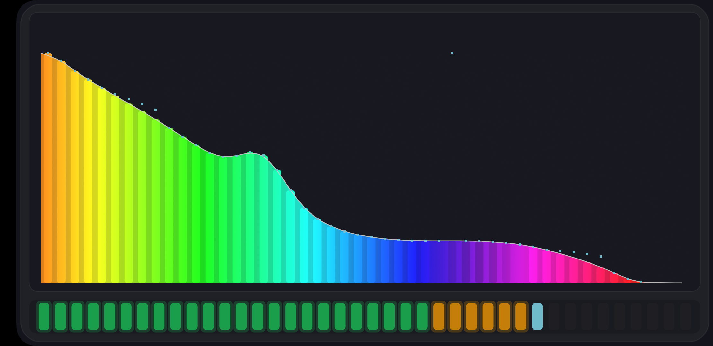
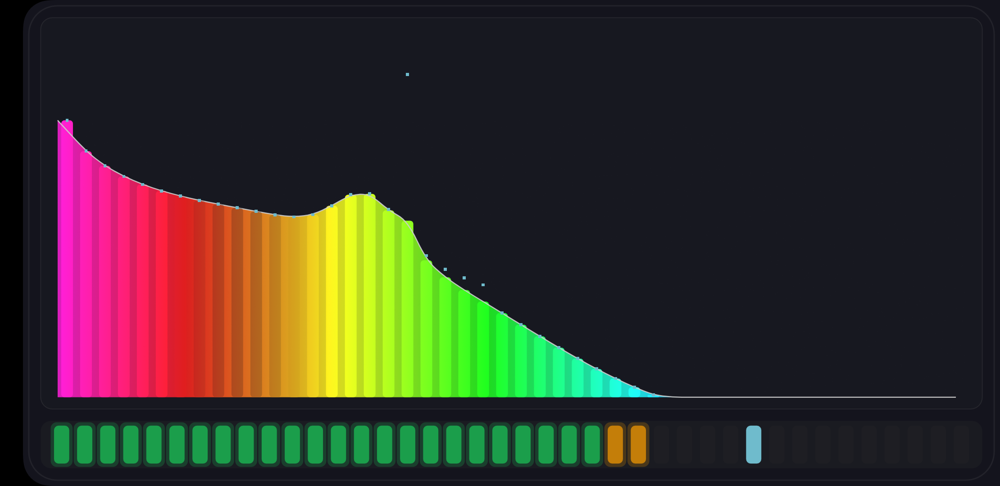
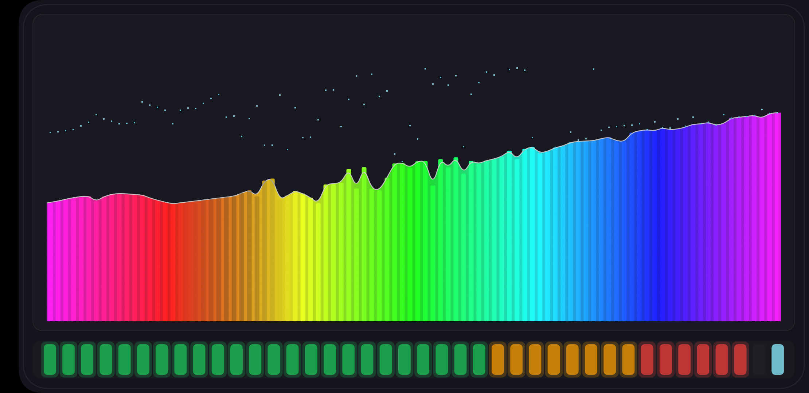
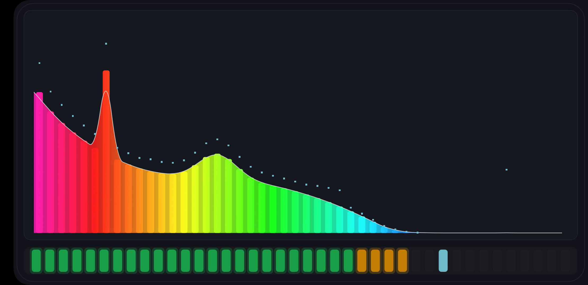
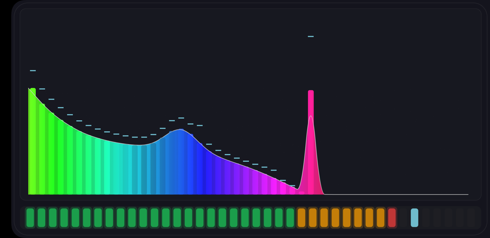
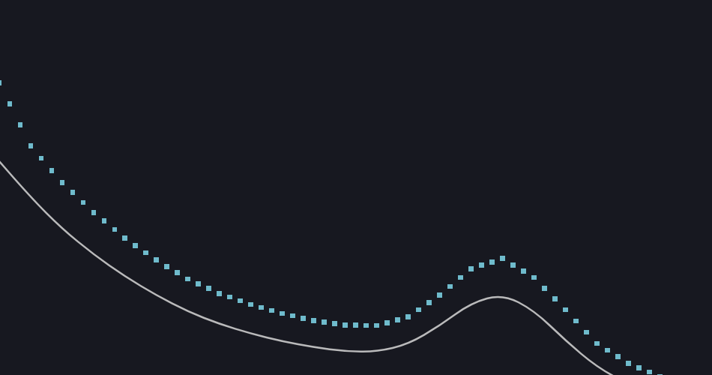

# 布局收紧：去掉黑框与无效区域 · 2026-10-17

用户反馈：**「当前 APP 的黑框和无效区域太多 缩小」**。

## 改了什么

频谱原来只从「卡片高度的 38%」才开始画，上面一大片是空的（早期留给歌词/品牌区），
外面还套着 3.5% 的机身外边距 + 4.5% 内边距。

| 量 | 原值 | 现值 |
|---|---|---|
| 机身外边距 | min(w,h)×3.5% | **×1.2%** |
| 机身内边距 | 机身高的 4.5% | **2.5%** |
| LED 条高 | 13% | **10%** |
| 条带间距 | 4.5% | **2.5%** |
| 频谱上沿 | 卡片高的 **38%** | **14.5%**（紧贴菜单行下方）|
| 频谱下沿 | 94% | **97%** |

**效果：频谱可用高度 414px → 717px（+73%）**，机身几乎贴边。

| 收紧前 | 收紧后 |
|---|---|
|  |  |

## 有一条消不掉的缝（已确认是系统行为）

屏幕最左侧仍有 **51px 纯黑**。查下来：

```
dumpsys window displays → init=1080x2220 cur=2220x1080 app=2124x1080
dumpsys window windows  → Requested w=2169 h=1080
```

即系统横屏时给状态栏留了区域，App 窗口只有 2169 宽且**靠右**摆放，最左 51px（2.3%）App 画不到。

试过但**无效**的手段：
- `FLAG_LAYOUT_NO_LIMITS`、`FLAG_LAYOUT_IN_SCREEN`、`FLAG_LAYOUT_INSET_DECOR`
- onResume 后再延迟 400ms 重设沉浸标志 + `setLayout(MATCH_PARENT)`
- 把机身底色改纯黑去"掩盖"这条缝 —— 也不行：**Flyme 夜间模式会把 App 内的纯黑填充
  改写成 `(20,20,29)`**，而系统那条是 `(0,0,0)`，色值对不上，缝依然可见。

结论：这 51px 是 ROM 级的窗口分配限制，App 侧无法消除（除非换 ROM/关夜间模式）。
App 自身的黑框与空白已压到最小。

---

## 附：音源模式谱线密度与麦克风对齐（同一天）

用户反馈：**「使用设备内音源的时候，所有样式谱线的密度变低了」**。

原因：音源路（`Visualizer` 抓全局混音）当初怕 `captureSize` 上限 1024 导致"一根柱子一个 bin"，
把柱数压到了 **32**，而麦克风路是 **96**。

现在改成 `SystemMixProvider.BANDS = PcmProvider.BANDS`（**96**，两边共用一个常量，避免以后再走偏）——
分带表本身有几何中心插值，窄于一个 bin 的频带会被平滑补出来，不会出现台阶。

| | 柱数 | 典型渲染 | 极端（全部顶满）|
|---|---|---|---|
| 麦克风路 | 96 | 2.7 ms / 60 fps | ~7 ms / 57 fps |
| 音源路（改前）| 32 | 3.2 ms / 60 fps | — |
| 音源路（改后）| **96** | **3.16 ms / 60 fps** | 11.8 ms / 51 fps |



---

## 附：让峰值点真正"被抛出去"（同一天）

用户反馈：**「现在峰值点最高的幅度等于柱形或波形震荡的幅度……这个频谱幅值变化得越快，
峰值点被抛得越高」**。

机制早就在（按原始 dB 的包络速率算冲高），但看不到效果，原因有两个：

1. **冲高没锁存**：速率在瞬态刚开始最大，柱子要几十~上百毫秒才涨到顶；直接把瞬时速率加到
   当前值上，等柱子涨到顶时冲高早就没了 → 峰值点最终只等于柱高。
   **改为：升完再保持 150 ms，之后按 300 ms 时间常数衰减。**
2. **上方没空间**：峰值点与柱子共用同一个 1.0 顶，柱子一顶到天花板峰值点就无处可去。
   **改为：柱形/面积/包络线只画 86% 高度，峰值点用满高度；自动量程 P95 锚点 0.9 → 0.72。**

**实测**（假频谱 150 ms 方波瞬态，频谱高 717px）—— 柱子到达最高点那一帧：

| 频带 | 柱顶 y | 峰值点 y | 高出 |
|---|---|---|---|
| 6 | 266 | 165 | **101 px** |
| 18 | 267 | 165 | **102 px** |
| 30 | 323 | 165 | **158 px** |
| 42 | 382 | 165 | **217 px** |



---

## 附：四处交互/显示修正（同一天，用户一次反馈）

### 1. 音源模式 LED 表恒满、不随增益变化

音源路的 `lastRmsDb` 原来加了 `MIX_GAIN_DB = +30`（早期为了让 VU 落在 −45~0 dBFS 刻度内），
而 VU 表是**绝对刻度** → 加了补偿后恒定顶满，再调增益也看不出变化。

**改**：音源路 rms 不再加补偿（保持原始 dB），量程由渲染器按模式给：
**麦克风 −45 dBFS / 音源 −75 dBFS**（音源捕获天生低约 30 dB）。

实测（亚低频测试音）：增益 0 时约 20 颗绿；增益 +22.6 时明显变长并出现琥珀/红 ✓

### 2. 「0s」与「关」区分开

峰值菜单由 `关 / 0.5s / 1s / 2s` 扩为 **`关 / 0s / 0.5s / 1s / 2s`**：

- **关** = 完全不画峰值点；
- **0s** = 照常抛出去，但不保持，**立刻按 2.8 屏/秒下落**（其余档是保持后按 1.6 屏/秒）。

实测（柱形档、假频谱）：带 42 的抛出高度 101 → **182** → 174 → 137 → 103 → 86 px，
即抛出后立即下落，没有悬停段 ✓

### 3. 波形档峰值点加密

包络是连续曲线，点却按 96 个带画会显得稀。**波形档改成在相邻带之间插值、密度翻倍**（192 点）。

### 4. 柱形档峰值点改成"和柱子一样宽的小矩形"

原来是无条件的小方块（`max(4, bandW*0.16)`）。现在：

| 样式 | 峰值点形状 |
|---|---|
| 柱形 / 密线 / 疏线 | **与下方谱线等宽的小矩形帽**（宽 = `barW`，高 = `max(5, bandW*0.12)`）|
| 波形 | 小方块，**密度翻倍**（相邻带插值）|
| 三角 / 面积 / 实心 | 小方块（保持原样）|

---

## 附：峰值点"一个频率出现两个" + 抛得不够高（同一天）

### 1. 波形档每带画了 2 个大点

为了让点更密，我给波形档在相邻带之间插值、每带 2 个点。但那两个点是
**12.6px 宽、间隔 21px** 的大方块 —— 看上去就是"同一个频率两个点"。

**改**：每带 **3 个**点、边长降到 `bandW*0.16`（约 2.5~3px），连成一条细点线；
并跳过会画到频谱右边界之外的点。

### 2. 柱形档的帽贴着柱顶时也画

柱形档的帽原来无条件画在柱顶上方 `capH/2` 处 —— 峰没抛起来时，帽 + 柱顶看起来就是两个点。

**改**：**只在峰确实抛离柱顶（高度差 > 1.1×帽高）时才画这个帽**。

### 3. 抛出力度加大

| 参数 | 原值 | 现值 |
|---|---|---|
| `BOOST_PER_DB_RATE` | 0.0009 | **0.0022** |
| `MAX_BOOST` | 0.32 | **0.45** |
| 死区 | 25 dB/s | **20 dB/s** |

**实测**（柱形档、假频谱，频谱高 717px）：

| 频带 | 柱最高那一帧高出 | 全程最大 |
|---|---|---|
| 6 | 101 px | 443 px |
| 18 | **473 px** | 476 px |
| 30 | 225 px | **705 px** |
| 42 | 253 px | 703 px |



