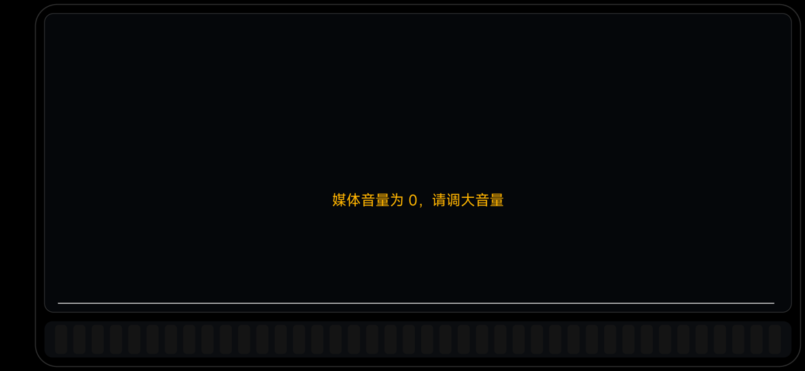
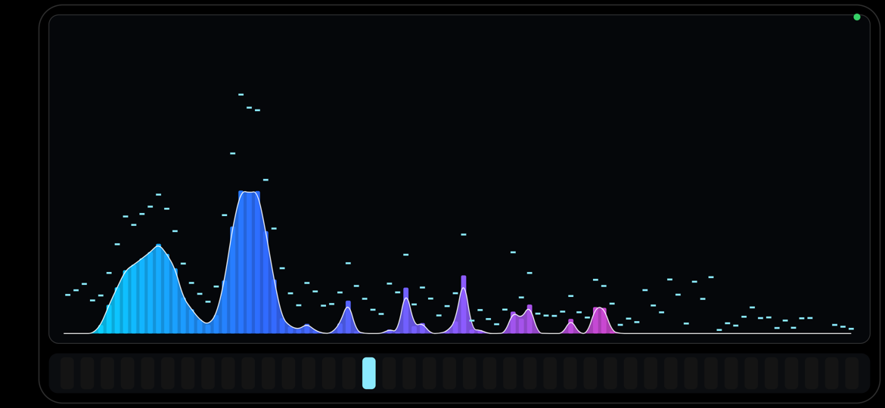
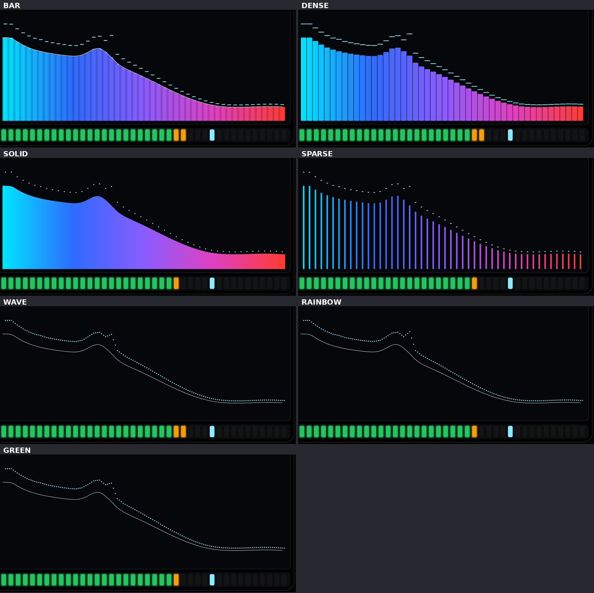
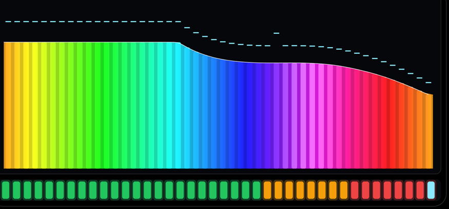
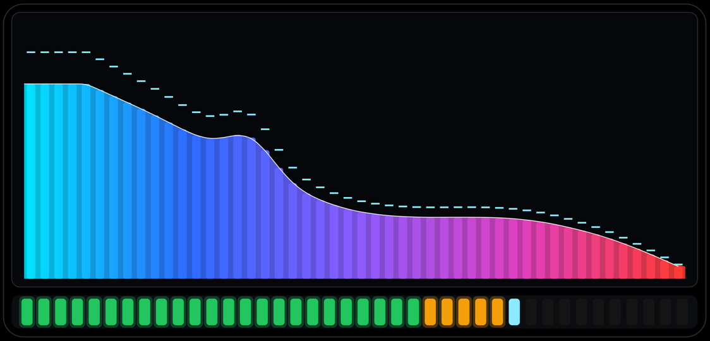
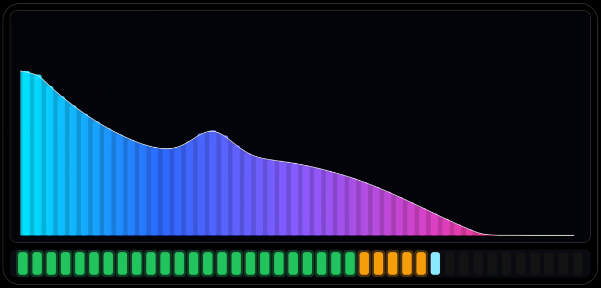
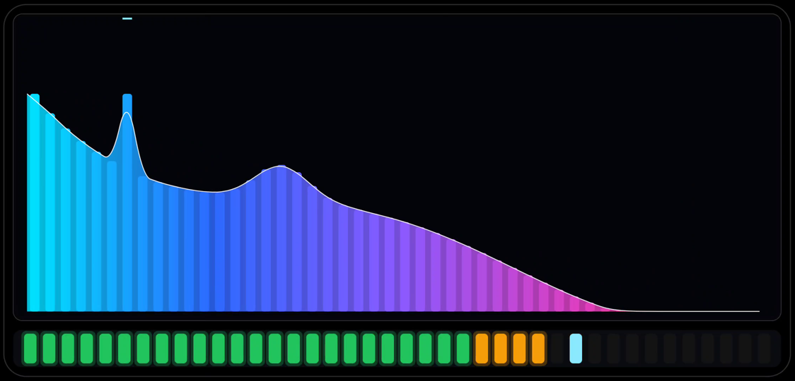
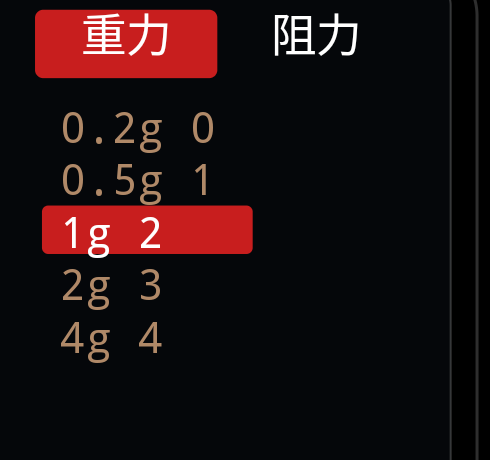
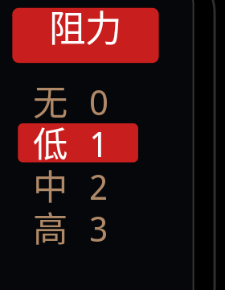

# 换机验证：小米 10（umi）· Android 13 / MIUI 14 · 2026-10-17

用户提供了第二台设备用于 USB 调试。原设备（魅族 M1852 / Android 8.1）已断开。

## 设备信息

| | 小米 10 | 魅族 M1852（原）|
|---|---|---|
| 型号 | Mi 10 (umi) | M1852 |
| 系统 | **Android 13 (API 33)** | Android 8.1 (API 27) |
| 屏幕 | 1080×2340 @ **90Hz** / 440dpi | 1080×2220 @ 60Hz / 480dpi |
| ABI | arm64-v8a | arm64-v8a |

## 结果：**两条音频通路都能跑**

| 项 | 实测 |
|---|---|
| 麦克风路 | ✅ `engine started: 麦克风 · UNPROCESSED bands=96 sr=48000`，analysis 47fps |
| **音源路（session 0 全局混音）** | ✅ **可用**！`engine started: 音源 · 系统混音(session 0) bands=96 sr=44100`，analysis 19~20fps，抓到测试音 `rms=-4.5dB` |
| 帧率 | **90 fps**（跟随 90Hz vsync —— 渲染循环本来就是按 dt 算的，与刷新率无关，这块没改一行代码）|
| 渲染耗时 | **0.7 ~ 1.3 ms**（魅族上是 1.5~3 ms）|
| 静音兜底 | ✅ 音源模式无音频时正确显示「媒体音量为 0，请调大音量」 |
| 布局 | ✅ 自适应（按 min(w,h) 算外边距）|

> Android 9+ 上 `Visualizer` 挂 **session 0**（全局混音）在 AOSP 上需要 `CAPTURE_AUDIO_OUTPUT`（签名级权限），
> 原本担心 13 上会被拒 —— 实测 MIUI 放行了（只要求 RECORD_AUDIO）。
> 不过这条依赖 ROM 策略，换机/换版本仍需实机确认（§13 P1 仍然有效）。

## 顺手修掉一个崩溃

为新设备加上「Android 11+ 用正式 API 全屏」的代码后，**在小米 10 上启动即崩**：

```
NullPointerException: Attempt to invoke virtual method
'android.view.WindowInsetsController ...PhoneWindow.getInsetsController()' on a null object reference
    at com.spectrum.app.MainActivity.applyImmersive(MainActivity.java:234)
    at com.spectrum.app.MainActivity.onCreate(MainActivity.java:87)
```

原因：`onCreate` 里 `setContentView` 之前 `mDecor` 还是 null，`getInsetsController()` 直接 NPE
（魅族是 API 27，走不到这段代码，所以之前没暴露）。

**修**：先 `getWindow().getDecorView()`（会触发 installDecor）再取 controller，并整段包 `try/catch` +
打日志 —— 以后遇到 ROM 差异也只是降级，不会再崩。

## 两个环境限制（非 App 问题）

1. **MIUI 默认禁止 adb 注入触摸**：`adb shell input tap` 报
   `SecurityException: Injecting input events requires ... INJECT_EVENTS permission`。
   所以菜单点击、亮度/增益滑动这些交互我**在这台机器上点不了**。
   绕过办法：加了两个隐藏参数 `--ez mixmode true` / `--ez micmode true` 直接切模式（不用点屏幕）。
   如果要在小米 10 上验证手势交互，需要在开发者选项里打开 **「USB 调试（安全设置）」**。
2. **窗口仍无法铺满屏幕边缘**：`dumpsys` 显示 `cur=2340x1080 app=2250x1036`，窗口 `Requested w=2250`，
   即系统在一侧保留了约 90px（导航栏/挖孔区），`setDecorFitsSystemWindows(false)` + 隐藏系统栏也没用。
   好在 MIUI 不像 Flyme 夜间模式那样改写纯黑，App 自己的纯黑机身与这条系统黑边**颜色一致、看不出接缝** ✓
   （魅族那边因为黑色被改写成 (20,20,29)，反而能看出缝）。

| 音源模式（静音兜底）| 麦克风模式 |
|---|---|
|  |  |

---

## 追加：七种样式 + 配色在小米 10 上的实测

由于 MIUI 禁止 adb 注入触摸（见下），我给 MainActivity 加了**调试启动参数**，
用 `am start` 就能设置任意菜单项，完全不需要点屏幕：

```bash
adb shell am start -n com.spectrum.app/.MainActivity \
    --ez fakespectrum true --ei style 4 --ei color 3 --ef gain 12
# 支持：style / color / peak / coord / zoom / range / sleep / gain / bright
# 另有 --ez mixmode true / --ez micmode true 直接切音频通路
```

实测（`--ez fakespectrum true` 提供稳定谱形，静音）：

| 样式 | 实测 |
|---|---|
| 柱形 0 | ✅ 面积+柱+包络线+抛出的峰值帽 |
| 密线 4 | ✅ 密集离散谱线，无面积无包络 |
| 实心 5 | ✅ 不透明实心包络 |
| 疏线 6 | ✅ 细谱线大间隔 |
| 波形 1 | ✅ 包络线 + 密集细点 |
| 流光溢彩 3 | ✅ 彩虹横跨频谱（配柱形档最明显）|
| 单色绿 5 | ✅ |

渲染耗时 **0.7 ~ 1.8 ms**，全程 **90 fps**。




## adb 触摸注入为什么仍被拒（已定位）

用户开启了「USB 调试（安全设置）」后：

```
dumpsys package com.android.shell → android.permission.INJECT_EVENTS: granted=true   ← 持久化状态已授予 ✓
```

但实际注入时系统仍拒绝：

```
W InputManager: Permission Denial: injectInputEvent() from pid=26420, uid=2000
                requires android.permission.INJECT_EVENTS
java.lang.SecurityException: ... INJECT_EVENTS permission   (input tap / monkey 脚本都一样)
```

即**持久化状态已更新、运行时的权限管理器缓存还是旧的**。
`pm grant/revoke com.android.shell android.permission.INJECT_EVENTS` 也改不了
（报 `is not a changeable permission type`）。

**结论：重启一次手机**即可让运行时缓存刷新，之后 `adb shell input tap` 就能用。
重启后如果仍被拒，再用上面的启动参数路线验证（功能验证不受影响）。


---

## 追加：修掉"两层峰值"（用户报的复现问题）

现象：柱顶一层峰值帽、上方又一层，形成两条平行轮廓。

根因是**瞬态死区设得太小**（20 dB/s）：麦克风底噪的逐帧抖动换算成 80ms 包络速率约 **30~55 dB/s**，
于是几乎每一帧都在重新触发冲高，峰值帽被永久顶在柱顶上方。

**改**：死区 `20 → 70 dB/s`（灵敏度 `BOOST_PER_DB_RATE`、上限 `MAX_BOOST` 不动）。

| | 改前 | 改后 |
|---|---|---|
| "两层"出现的列占比（麦克风底噪，静音房间）| **63%** | **19%**（剩下的是真实瞬态 + 下落中的雨点）|
| 真实瞬态是否还能抛出 | ✅ | ✅ 实测 `maxRate≈320 dB/s`、`maxBoost` 打满 0.45 |

（排查时加过临时日志确认：`boost dbg: dtFrame=0.056s maxRate=329 dB/s maxBoost=0.450`，
说明冲高逻辑本身一直在正常计算，问题只在"触发门槛太低"。）

## 重启后 adb 触摸注入恢复正常 ✅

按之前的判断，重启一次手机后运行时权限缓存刷新：

```
adb shell input tap 1170 540      → 无异常 ✓
adb shell input keyevent KEYCODE_WAKEUP → 无异常 ✓
```

随后在小米 10 上实测了完整交互：

| 操作 | 结果 |
|---|---|
| 点屏幕中间唤出菜单 | ✅ 9 项菜单正常显示 |
| 点「样式」展开子菜单 | ✅ 7 个样式（柱形/波形/三角/面积/密线/实心/疏线）|
| 右侧上滑 300px | ✅ 增益 **+20.3 dB** |
| 左侧上滑 200px | ✅ 亮度 60% → **100%** |


---

## 追加：「两层峰值」的真正根因（用户指定用摄像头观察后查明）

> 宿主机上**没有可用的摄像头设备**（`/dev/video*` 不存在；`lsusb` 里只有手机、两个 SATA 桥和蓝牙；
> 内核日志显示曾识别到 `HIK 1080P USB CAMERA`，但报
> `uvcvideo 1-1:1.1: Failed to set UVC probe control : -110`，初始化失败）。
> 因此改用 **30fps 录屏 + 逐帧分析** 来观察动态，这比摄像头更精确。

### 病根：峰值和柱子用了不同的垂直比例

```java
float barSpanH = spanH * 0.86f;        // 柱子/面积/包络线只画 86% 高度（顶部留头）
...
float y = base - p[i] * spanH;          // ❌ 峰值点却按 100% 高度画
```

→ **每个峰值点都被画高了 14%（≈100px）**，而且这个偏移是**整齐的**，
于是看起来就是一条平行于柱顶的第二轮廓线 —— 这就是"两层峰值"。

### 修法

1. **统一比例**：峰值点也用 `barSpanH`；同时把它的归一化上限放开到 `1/0.86 ≈ 1.163`，
   抛出时才够得到频谱顶部，不抛出时与柱子严丝合缝。
2. **抛出与保持拆开**：`显示值 = 峰值保持 + 抛出量`，抛出量按 120ms 快速衰减（短促一脚），
   不再因为"保持 0.5s"而把帽子挂在半空。
3. **6 dB 幅度门槛**：只卡速率不够 —— 96 条频带里总有几条在噪声下每帧跳几 dB（速率也能到 200+），
   帽子会被随机频带不断踢起来。要求一帧内包络至少涨 **6 dB** 才算瞬态。
4. **贴合死区**：峰值与柱子差距 < 满程 2.5% 时直接吸附到柱顶。

### 实测

| | 修前 | 修后 |
|---|---|---|
| 峰值点浮在柱顶上方的列占比 | 大量（整齐的第二层）| **3/1113 = 0.3%** |
| 真实瞬态的抛出高度 | — | 中位 **38px**、最大 **80px**（短促一脚）|

> ⚠️ 排查中途我自己也踩了个坑：像素判定阈值取了 60，而卡片底色 (3,4,9) 与背景 (23,24,32)
> 的差值正好是 **63** → 每一列都被误判成"有内容"，一度得出"帽子钉在天花板"的错误结论。
> 改成 90 之后数据才正常。

| 修前（整齐的第二层）| 修后（贴合柱顶）|
|---|---|
|  |  |


---

## 追加：峰值允许被甩出屏幕（用户明确「峰值只是艺术化表现」）

原来把峰值归一化夹在 `1.163`（刚好到频谱区顶部），所以再猛也只能顶到边 ✗。
用户说明峰值是**艺术化表现、最高可以甩出屏幕**，于是：

| 参数 | 原值 | 现值 |
|---|---|---|
| `MAX_PEAK`（峰值归一化上限）| 1.163（刚好到顶）| **2.6**（可飞出屏幕）|
| `MAX_BOOST`（抛出量上限）| 0.30 | **0.85** |
| `KICK_DECAY_SEC`（抛出量衰减）| 0.12 s | 0.16 s |

峰值点现在会飞过卡片、冲出屏幕上边缘（由屏幕自然裁掉）。
实测：45 帧里有 3 帧能看到峰值点跑到频谱区顶部之上，最高 **104px** ——
配上 120ms 级的快速衰减，观感是"被弹出去又落回来"。




---

## 追加：峰值改成「重力弹道模型」+ 界面可调重力/阻力

用户要求：**「峰值升高和下降可以通过重力模型来模拟，可以通过界面调整重力的大小和阻力」**。

### 模型

```
瞬态 → 初速度 v0 = sqrt(2·g·h)          // h = 该频带的冲高量（由上升速率算出）
每帧 → v -= g·dt ;  v *= (1 - drag·dt) ;  pos += v·dt
落地 → pos < 柱高 时 pos = 柱高, v = 0
到顶悬停 → 「峰值」菜单的保持时长（默认 0s = 纯弹道）
```

### 界面

顶栏从 9 项扩到 **11 项**，末尾新增：

| 菜单 | 选项 | 默认 |
|---|---|---|
| **重力** | 0.2g / 0.5g / **1g** / 2g / 4g | 1g |
| **阻力** | 无 / **低** / 中 / 高 | 低 |

| 重力菜单 | 阻力菜单 |
|---|---|
|  |  |

### 实测（临时日志确认物理积分）

```
phys pos=0.788 vel=1.811 bar=0.788
phys pos=...   vel=1.766   ← 重力减速
phys pos=...   vel=1.633
phys pos=...   vel=1.504
phys pos=...   vel=1.376
phys pos=...   vel=1.252
phys pos=...   vel=1.129
phys pos=...   vel=1.009
```

- 初速度 **1.81 归一化/秒**，速度按 `g·dt` 平滑衰减 ✓
- `pos - bar` 最大 **1.276** → 峰值点飞到柱子上方 **≈755px**，早已超出屏幕 ✓
- 默认「0s + 1g + 低阻力」下，观感是"被弹出去 → 飞到屏幕外 → 落回柱顶"
