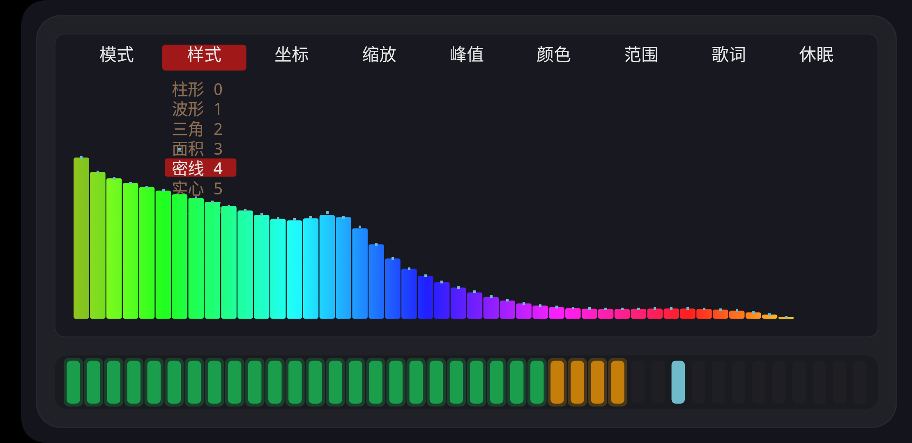
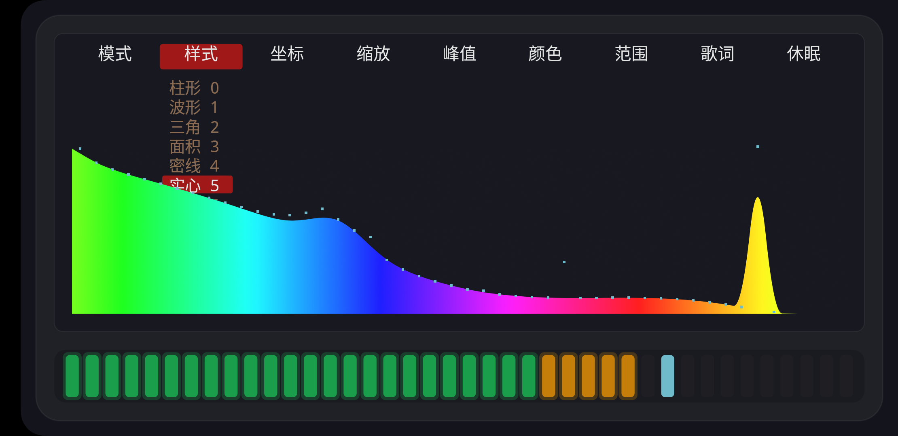
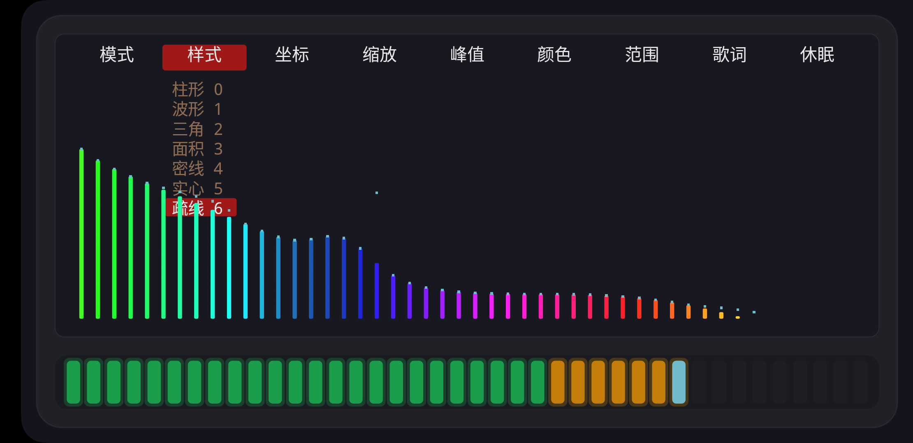

# 新增三种频谱样式 · 2026-10-17

用户要求（原话）：**「1. 只显示密集的离散的谱线 不显示包络 2. 不显示任何谱线 把包络搞成实心的
3. 只显示谱线，稀疏的」**

「样式」菜单从 4 档扩到 **7 档**：

| # | 样式 | 面积 | 谱线 | 包络线 | 柱宽占比 |
|---|---|---|---|---|---|
| 0 | 柱形（默认） | ✅ | ✅ | ✅ | 0.62 |
| 1 | 波形 | — | — | ✅ | — |
| 2 | 三角 | — | 三角 | — | — |
| 3 | 面积 | ✅ | — | ✅ | — |
| **4** | **密线** | — | ✅ 小圆角 | — | **0.94** |
| **5** | **实心** | ✅ **不透明** | — | — | — |
| **6** | **疏线** | — | ✅ | — | **0.26** |

| 样式 | 效果 |
|---|---|
|  | **密线**：密集离散谱线，柱间几乎相接，**没有面积、没有白包络线** |
|  | **实心**：完全没有谱线，只有**不透明的实心包络**（也没有白色描边） |
|  | **疏线**：细谱线 + 大间隔，同样没有包络 |

## 实现

`drawSpectrum` 把四个绘制层各自挂一个开关，样式只决定这几个参数：

```java
boolean drawArea = style == 0 || style == 3 || style == 5;
boolean drawBars = style == 0 || style == 4 || style == 6;
boolean drawTri  = style == 2;
boolean drawLine = style == 0 || style == 1 || style == 3;
float barFactor  = style == 4 ? 0.94f : (style == 6 ? 0.26f : 0.62f);
int   areaAlpha  = style == 5 ? 255 : 215;
```

以后再加样式，改这张表即可。「流光」高光现在跟着 `drawBars` 走，所以密线/疏线档也有流动效果。

## 复现

```bash
adb shell am start -n com.spectrum.app/.MainActivity --ez fakespectrum true
# 点屏幕中间唤出菜单 → 「样式」→ 选「密线 4 / 实心 5 / 疏线 6」
```
