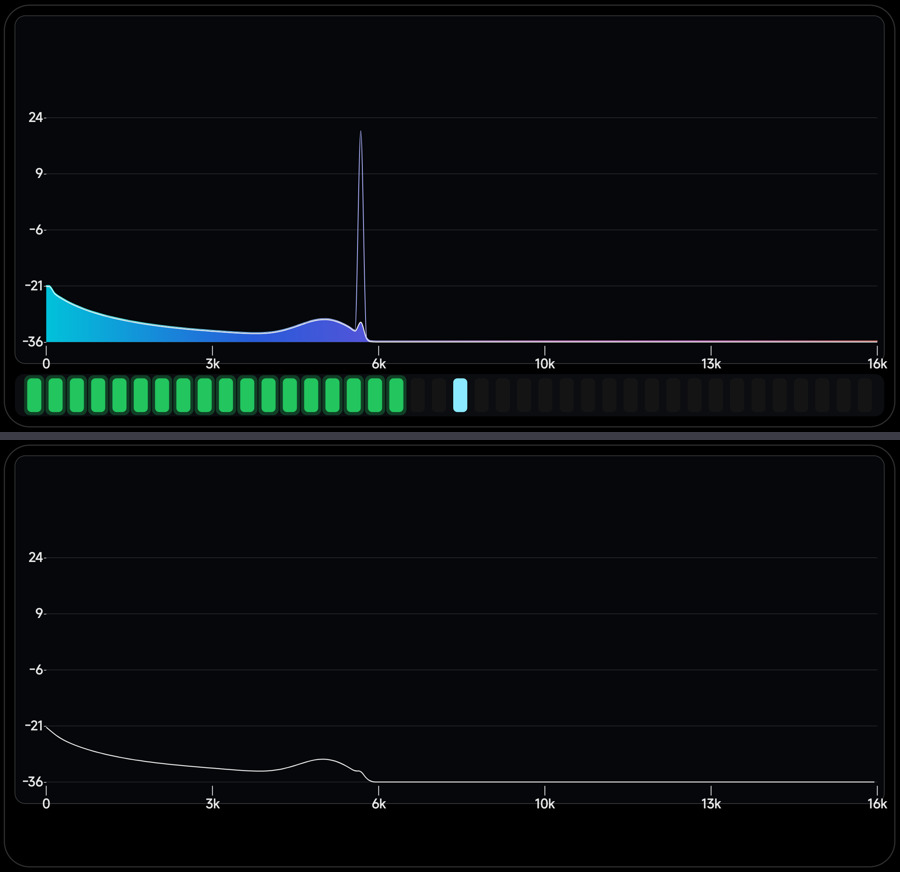
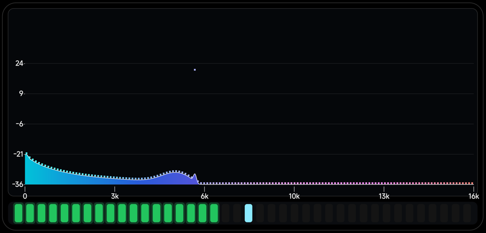
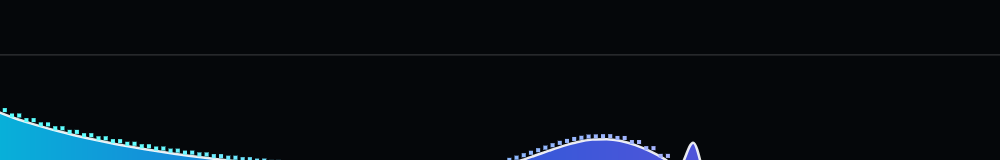

# 峰值曲线与频谱曲线错位的原因与修复 · 2026-11-07

用户：**「为什么最大值的曲线和频谱的曲线看起来有错位，最大值曲线有时候会落进频谱曲线」**。

## 原因：两条曲线用了不同的 x 位置和不同的插值

| | 频谱曲线 | 峰值曲线（修前）|
|---|---|---|
| 顶点 x | `left + (i + 0.5) × bandW`（带中心）| `left + i × bandW`（带左沿）|
| 插值 | 单调三次（Fritsch–Carlson）| `quadTo` 二次贝塞尔 |
| 过冲 | 无 | 有 |

x 差了半格、插值方式也不同 → 两条线在视觉上错位，下降沿处峰值线会被频谱线"顶穿"。

## 修复

抽出两个通用助手，**两条曲线用完全相同的顶点位置和插值**：

```java
private void monoSlopes(float[] y, float[] m, int n, float dx)   // 单调切线
private void buildMonoPath(Path out, float[] y, float[] m, ...)  // 单调三次曲线
```

峰值曲线额外做两点保证：

```java
for (int i = 0; i < bands; i++) {
    float py = base - p[i] * barSpanH;
    if (py > areaY[i]) py = areaY[i];                       // 顶点不低于频谱曲线
    peakY[i] = py - Math.max(2.5f, bandW * 0.12f);          // 再整体上抬一点
}
monoSlopes(peakY, peakM, bands, bandW);
buildMonoPath(areaPeakPath, peakY, peakM, left, right, bandW, bands);
```

现在峰值曲线和频谱曲线**同 x、同插值**，且逐点不低于频谱 → 不会再交叉/掉进去。
波形档和面积档共用这段逻辑。




---

## 面积档的峰值改回「点」（2026-11-07）

用户：**「把样式-面积的最大值的连续曲线改成点」**。

- 波形档：峰值 = **连续曲线**（不变）；
- 面积档：峰值 = **每带 1 个点**，点的 x 与频谱曲线同位置，y 取 `min(峰值, 频谱曲线)` 再上抬 0.75 个点高
  —— 所以既是点阵，又不再掉进频谱里。

```java
} else if (style == 4) {
    float s2 = Math.max(4f, bandW * 0.55f);
    for (int i = 0; i < bands; i++) {
        float py = base - p[i] * barSpanH;
        if (py > areaY[i]) py = areaY[i];        // 不低于频谱曲线
        float y = py - s2 * 0.75f;
        float x = left + (i + 0.5f) * bandW;
        tmp.set(x - s2 / 2f, y - s2 / 2f, x + s2 / 2f, y + s2 / 2f);
        c.drawRect(tmp, peakPaint);
    }
}
```




### 再调：点更小、更密（2026-11-07）

| 项 | 上一版 | 现在 |
|---|---|---|
| 密度 | 每带 1 个 | **每带 2 个**（相邻带插值）|
| 尺寸 | `max(4, bandW×0.55)` ≈ 7.7px | **`max(2.5, bandW×0.28)` ≈ 4px** |
| 总点数 | 144 | **288** |


