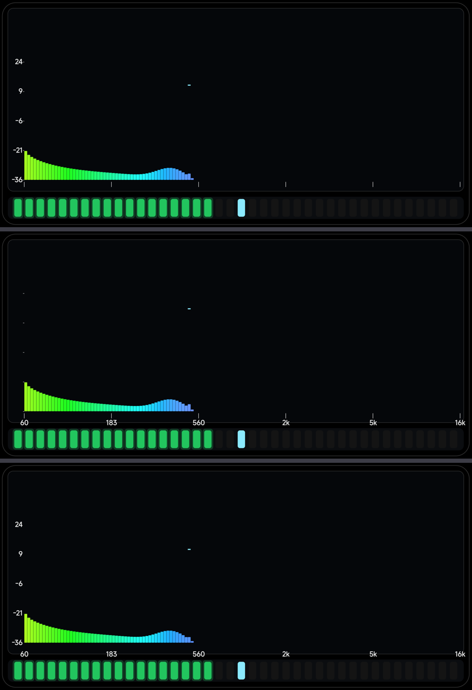
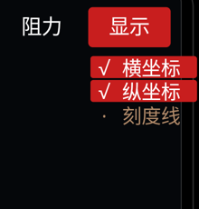
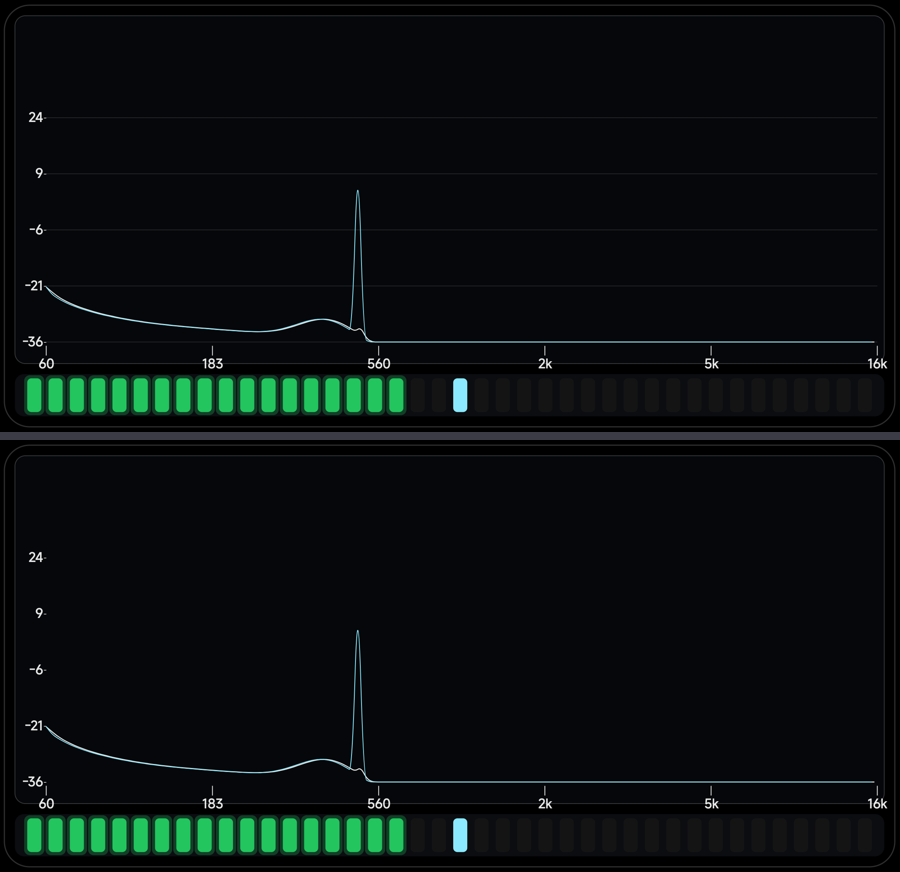
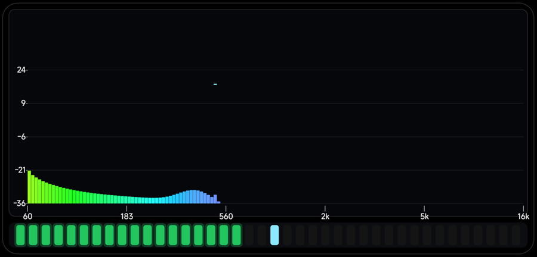

# 新增「显示」菜单：横坐标 / 纵坐标 / 刻度线 三个独立开关 · 2026-11-07

用户：**「增加一个 显示 按钮 用来控制 1.横 2.纵坐标 3.横坐标线是否显示」**。

## 设计

顶栏第 11 项「显示」。和别的菜单不同，它**不是单选**，而是**三个独立开关**（多选）：

| 选项 | 控制什么 | 位 |
|---|---|---|
| 横坐标 | 底部频率数字（60 / 183 / 560 / 2k / 5k / 16k）| bit0 |
| 纵坐标 | 左侧 dB 数字（−19 … −53）| bit1 |
| 刻度线 | 那些小刻度短线（横轴竖短线 + 纵轴横短线）| bit2 |

- 状态存成**位掩码**（`sel[DISPLAY]`，0..7），默认 **7 = 全开**，和其它设置一起持久化；
- 菜单里每行显示 `√ 横坐标` / `· 刻度线`，点一下翻转并**保持菜单打开**，可以连着点；
- 列表项"选项索引"的检查对 DISPLAY 特判（否则点出 6 会被 `>= 选项数` 拦掉 —— 这就是第一版点了没反应的原因）。

## 实测（用 `--ei display <mask>` 直接设定）

| mask | 效果 |
|---|---|
| 7 | 全部显示 |
| 6 | 横坐标数字消失，刻度线仍在 |
| 5 | 纵坐标数字消失，刻度线仍在 |
| 3 | 两组数字都在，刻度线全部消失 |





---

## 追加：第四个开关「内部横线」（2026-11-07）

用户：**「增加第四个按钮 控制画面内部纵坐标的横线（横线位于图层的最底部）」**。

「显示」现在是 **4 个独立开关**（位掩码 0..15，默认 15 = 全开）：

| 选项 | 控制什么 | 位 |
|---|---|---|
| 横坐标 | 底部频率数字 | 1 |
| 纵坐标 | 左侧 dB 数字 | 2 |
| 刻度线 | 坐标轴上的短刻度标记 | 4 |
| **内部横线** | **图像内部、与纵坐标刻度对齐的横向贯穿线** | **8** |

**层级**：`drawGrid()` 在 `drawSpectrum()` 里**最先**调用（步骤 ⓪），所以柱子/面积/包络/峰值
全部盖在它上面 —— 也就是位于图层最底部：

```java
// ⓪ 图像内部横线：最先画 → 位于图层最底部，会被柱子/面积/曲线覆盖
if ((settings.sel[AppSettings.DISPLAY] & 8) != 0) {
    drawGrid(c, barSpanH);
}
// ① 面积填充 … ② 谱线 … ③ 包络 … ④ 峰值
```



