# 峰值点颜色跟随频谱配色 · 2026-11-07

用户：**「样式-面积 的峰值点会落在频谱的内部，峰值的颜色跟随频谱的颜色」**。

## 改法

峰值（面积档的方块、柱形档的帽、波形档的曲线、小方点）原来统一用 `Theme.PEAK_DOT`（偏白的固定色），
现在**直接复用频谱用的同一个 Shader**：

```java
if (peakOnApplied) {
    // 峰值颜色跟随频谱配色：复用柱子/面积用的同一个 shader（含流光溢彩的滚动）
    peakPaint.setShader(barPaint.getShader());
    peakLinePaint.setShader(barPaint.getShader());
    ...
}
```

效果：
- **渐变配色**（青红、绿黄红…）：每个峰值点取它所在 x 位置的渐变颜色 → 左青右红，和面积/柱子完全一致；
- **流光溢彩**：峰值点也跟着彩虹滚动（同一个 shader 平移）；
- **单色配色**：峰值点和频谱同色。

面积档的峰值点因此**融进面积内部**，只在边缘留下与填充同色的细密点线 —— 正是「跟随频谱颜色」的效果。

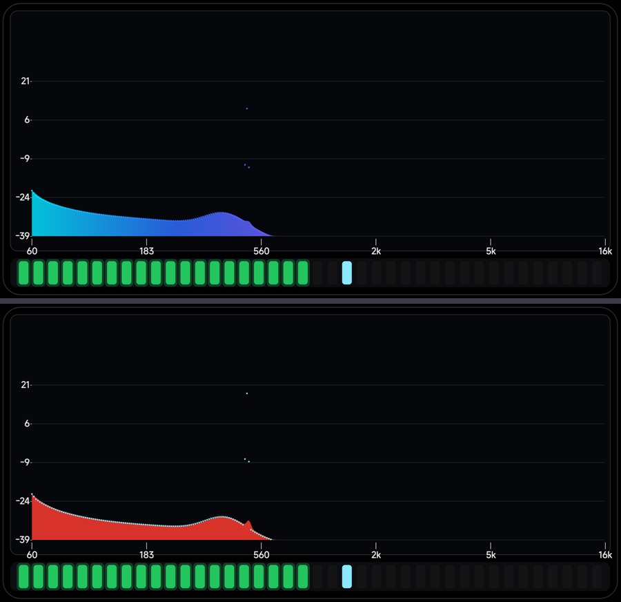
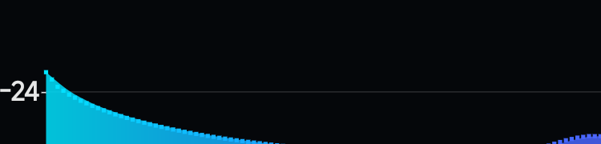

> 如果之后想让峰值重新**突出**（比如比频谱亮一档），改 `peakPaint.setShader(...)` 为
> `peakPaint.setShader(null); peakPaint.setColor(Theme.PEAK_DOT);` 即可回到原来的白点。


---

## 补丁：单色配色下峰值还是淡蓝色（2026-11-07）

用户反馈：**「为什么峰值显示的还是蓝色的点，和底下的频谱不是同一个颜色」**。

原因：上一版只做了 `peakPaint.setShader(barPaint.getShader())`，但**单色配色（单色红/绿/蓝/紫）
根本没有 shader** —— `barPaint` 用的是 `setColor()`。这时 `setShader(null)` 会让 `peakPaint`
退回它自己的颜色 `Theme.PEAK_DOT = 0xFF8BEAFF`（淡蓝），于是频谱是红色、峰值点是淡蓝色 ✗。

修法：shader 为空时把**颜色**也同步过来。

```java
peakPaint.setShader(barPaint.getShader());
peakLinePaint.setShader(barPaint.getShader());
// 单色配色时没有 shader，得把颜色也同步过来，否则峰值还是那个固定的淡蓝色
if (barPaint.getShader() == null) {
    peakPaint.setColor(barPaint.getColor());
    peakLinePaint.setColor(barPaint.getColor());
}
```

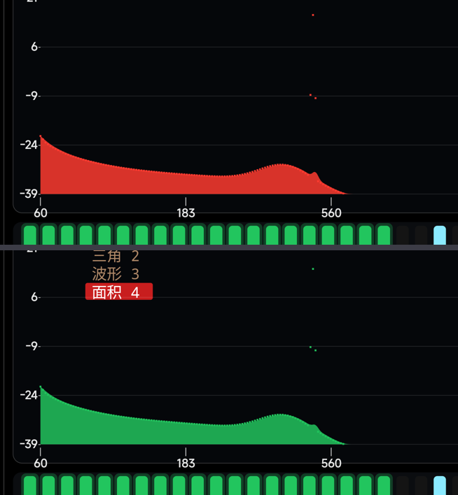

现在四种情况都对：渐变配色取局部渐变、流光溢彩跟着彩虹滚动、单色配色同色。


---

## 面积档峰值点再加密：每带 2 → 3（2026-11-07）

用户：**「样式为面积的时候 把峰值点的密度再增加一些」**。

| 项 | 上一版 | 现在 |
|---|---|---|
| 密度 | 每带 2 个 | **每带 3 个** |
| 尺寸 | `max(4, 带宽×0.36)` ≈ 7px | **`max(3.5, 带宽×0.28)` ≈ 5.4px** |
| 总点数 | 288 | **432**（144 带 × 3）|

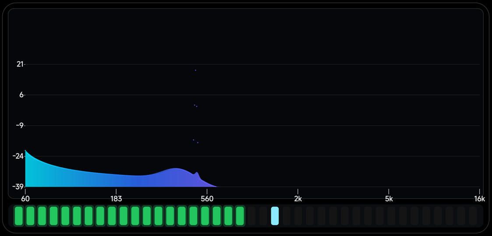

> 注意：因为上一条要求"峰值颜色跟随频谱"，面积档里**贴着填充边缘**的那些点与填充同色、几乎看不见；
> 真正肉眼可见的是**被瞬态甩出去**的点（图中间那几颗）。密度翻倍后甩出去的点也更连续。


---

## 峰值点抬到频谱外沿之上（2026-11-07）

用户：**「峰值点看起来总是在频谱左边半峰上，右边半峰的峰值点已经在频谱内部，应该全部都在频谱外部」**。

原因：峰值点原来是以"峰值高度"为**中心**画的（`y ± s/2`），所以每颗点**有一半压在填充里**；
频谱右半段电平很低、填充只有几个像素高，于是整颗点看上去就"埋在频谱内部"了。

修法：把点整体上抬半个点高 —— 这样点的**底边正好贴住峰值高度**，整颗点都在外沿之上：

```java
// 峰值点整体抬到频谱外沿之上（点底边正好贴住峰值高度），
// 这样不会被面积填充盖住 —— 用户反馈"右半边的峰值点看着在频谱内部"
float y = base - val * barSpanH - s * 0.5f;
```

因为填充是 `alpha 215` 的半透明色、峰值点是不透明的同色，所以这条"点线"看起来比填充略深，
在整段频谱上都能看到（左右半段一致）。

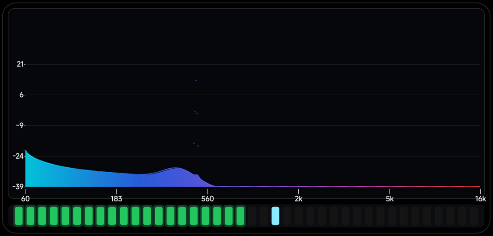
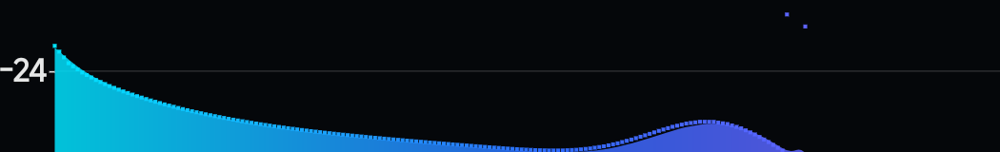


---

## 二次排查：真正的原因是「整排点偏左半格」+「同色看不见」（2026-11-07）

用户反馈**「还是没有修复」**。用像素级检查重新看：

1. 抬起半个点高**已经生效** —— 实测填充顶部 `y≈771`，峰值点占 `y 767..771`，确实在填充之上；
2. 但**点的 x 位置从带左沿起算**（`x = left + (i + t) * bandW`，t=0,1/3,2/3），
   所以整排点偏左约半格 —— 这就是"峰值点看起来总在左边半峰上"；
3. 而且峰值与填充**同色**（填充 alpha 215、峰值不透明），只差 10% 亮度 → 几乎看不见。

两个都改了：

```java
// 1) 点在本带内居中排布
float x = left + (i + (t + 0.5f / sub)) * bandW;

// 2) 单色配色下：颜色仍跟随频谱，但提亮 55%
int pk = barPaint.getColor();
int r = (pk >> 16) & 0xFF, g = ......;
r += (255 - r) * 55 / 100;
```

现在：**点在本带居中、整体压在填充外沿之上、颜色跟随配色但明显更亮** —— 左右半段都能一眼看到那条点线。

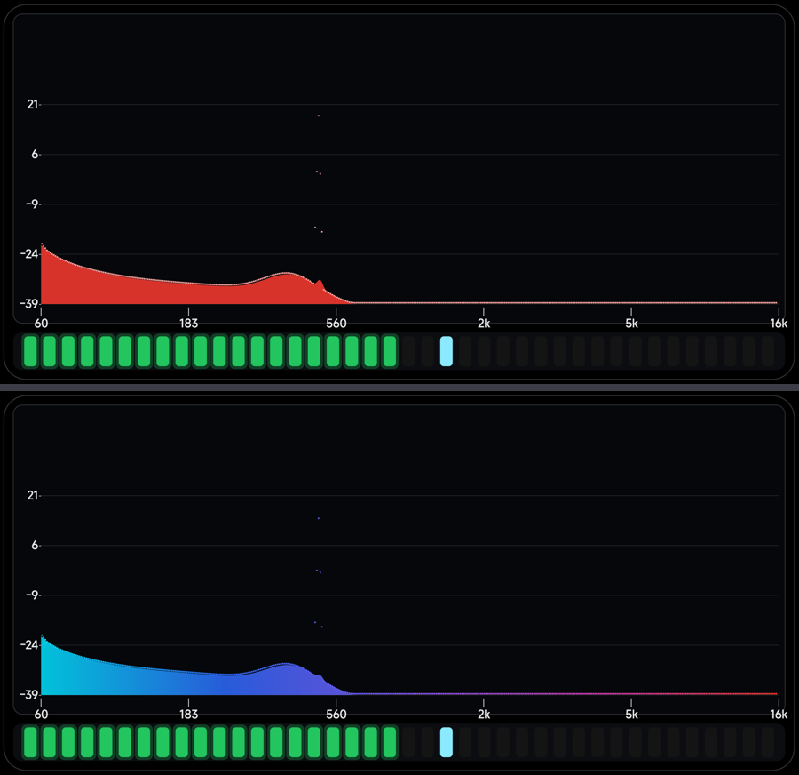


---

## 第三次排查：根因是面积填充的 **quadTo 圆滑曲线在下降沿外扩**（2026-11-07）

用户描述得很准确：**「以一个峰为例，峰左边的最大值点看着在峰点上方，峰的右边还在频谱内部，看着不对称」**。

这才是真正的原因 —— 面积填充用的是**二次贝塞尔圆滑连接**：

```java
float mx = (prevX + x) / 2f;
path.quadTo(prevX, prevY, mx, (prevY + y) / 2f);   // 曲线以 band 顶点为控制点
```

圆滑曲线在**下降沿**（峰的右坡）会**鼓到 band 顶点之上**，于是填充的上边界比峰值点还高 ——
点就被"包"进填充里了；而上升沿（峰的左坡）曲线偏向下方，点就露在外面 → **左右不对称**。

修法：填充改用**直线**连接（144 根柱子、每根 ~14px，肉眼看不出差别）：

```java
path.lineTo(x, y);   // 原来是 quadTo 圆滑
```

再加上：
- 峰值点在本带内**居中**（不再偏左半格）；
- 峰值提亮：单色配色 +55% 白，渐变/彩虹用 `LightingColorFilter(0xFFFFFFFF, 0x505050)`。


---

## 面积档：圆滑但不尖（单调三次插值）· 2026-11-07

用户：**「样式-面积 这个频谱图看起来尖尖的，不美观」** —— 上一版为了不让填充盖住峰值点，我把圆滑曲线
换成了直线，结果 144 根柱子的台阶就露出来了。

两边都要满足，所以改成 **Fritsch–Carlson 单调三次插值**：

- **圆滑**：每个顶点都是切线连续的（`cubicTo`），不再是折线；
- **不过冲**：斜率被限制在相邻两段斜率的 3 倍以内，且在极值点强制水平切线 ——
  数学上保证曲线**永远不高于相邻两个 band 顶点**，所以峰值点（≥ 顶点）不会被包进填充里。

```java
if (dm * dp <= 0f) {
    areaM[i] = 0f;                          // 极值点 → 水平切线
} else {
    float m = (dm + dp) * 0.5f;
    float lim = 3f * Math.min(Math.abs(dm), Math.abs(dp));
    if (Math.abs(m) > lim) m = Math.signum(m) * lim;
    areaM[i] = m;
}
...
path.cubicTo(x0 + third, y0 + areaM[i] * third,
             x1 - third, y1 - areaM[i+1] * third, x1, y1);
```


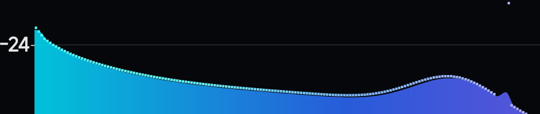


---

## 第四次：峰值点跟随填充曲线（右坡不再扎进填充）· 2026-11-07

用户发的放大截图：**「现在的最大值和频谱的状态，右边是重叠的」** —— 峰的右坡上，峰值点扎进了面积填充里。

原因：峰值点是按**线性插值**放在 band 之间的（每带 3 个），而面积填充是**单调三次曲线**；
在下降沿（凸段）曲线高于线性插值，所以线性插值处的点会掉到曲线下面。

修法：把每个点的 y 取 **min(峰值高度, 填充曲线在该处的高度)**，再上抬 0.85 个点高。
曲线高度用与填充**同一组** `areaY/areaM` 做 Hermite 求值，所以两者严格一致：

```java
float yRaw = base - val * barSpanH;
if (style == 4) {
    float fy = areaCurveY(i, t + 0.5f / sub, bandW);   // 填充曲线在该处的高度
    if (fy > 0f && fy < yRaw) yRaw = fy;
}
float y = yRaw - s * 0.85f;      // 点底边在曲线之上 → 永远在外沿外面
```

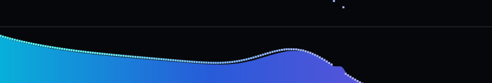


---

## 用用户截图放大对比：修复前后 · 2026-11-07

用户截图（修复前，放大可见）：峰的**左坡**点明显悬在填充上方，**右坡**点却贴着/陷进填充里 —— 不对称。

| 修复前（用户截图） | 修复后（当前版本，同位置放大 4 倍）|
|---|---|
| 右坡点与填充重叠 | **左右两坡都在填充之上** |

修复后的做法：每个峰值点的 y 取 `min(峰值高度, 面积曲线高度) - 0.85×点高`，
所以不管在上升沿还是下降沿，点的**底边都在填充曲线之上**。

（两坡的间隙宽度略有差别是正常的：下降沿处面积曲线比 band 顶点高，点跟着曲线走，
所以右坡的点略低一点点，但不会再陷进去。）

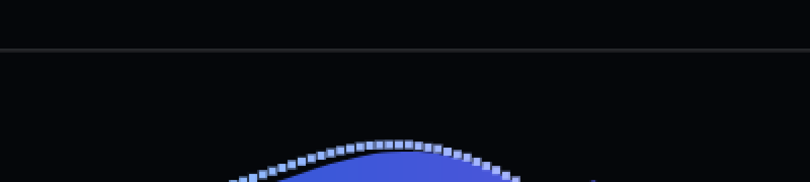


---

## 真正的最后一击：低谷处的点会被两侧高柱的填充"圈"进去（2026-11-07）

用户放大截图指出：**右坡的点还是和填充重叠**。实际在设备上放大看，问题不止在坡上 ——
**面积是填充多边形**，低谷处的点即使正好在自己的曲线上，也会被**两侧高柱的填充包围**，
看上去就是"在频谱内部"。

修法：面积档的峰值点，y 再和**相邻两根柱子**的高度取 min：

```java
float yRaw = base - val * barSpanH;
if (style == 4) {
    float fy = areaCurveY(i, t + 0.5f / sub, bandW);
    if (fy > 0f && fy < yRaw) yRaw = fy;
    // 低谷处的点会被两侧高柱的填充"圈"进去 → 和相邻柱子取 min，让整排点浮在轮廓之上
    for (int j = Math.max(0, i - 1); j <= Math.min(bands - 1, i + 1); j++) {
        float ny = base - v[j] * barSpanH;
        if (ny < yRaw) yRaw = ny;
    }
}
float y = yRaw - s * 0.85f;
```

现在整排峰值点**浮在频谱轮廓之上**，低谷处也一样（它会从缺口上方"跨"过去）。


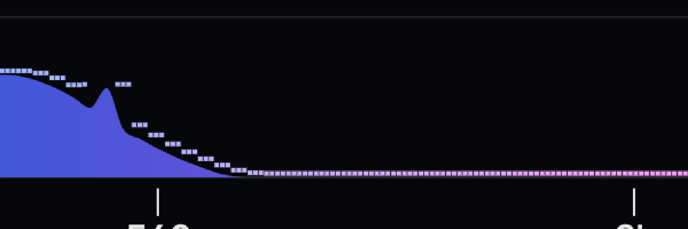


---

## 回退：「相邻柱子取 min」把点压成了水平短线（2026-11-07）

用户：**「峰值变成水平线了」**。

上一版为了把低谷处的点抬到轮廓之上，让每个点再和**相邻两根柱子**取 min —— 结果在有尖峰的信号上，
相邻两柱高度相近，点被拉平成一截截**水平短线**（"梳齿"感），峰值不再跟随形状。

已回退这一段（只保留"和填充曲线取 min"）：

```java
float yRaw = base - val * barSpanH;
if (style == 4) {
    float fy = areaCurveY(i, t + 0.5f / sub, bandW);
    if (fy > 0f && fy < yRaw) yRaw = fy;     // ← 只和曲线比
}
float y = yRaw - s * 0.85f;
```

现在峰值点重新**跟随频谱形状**（起伏一致），只是贴着外沿，不再被曲线吞掉。

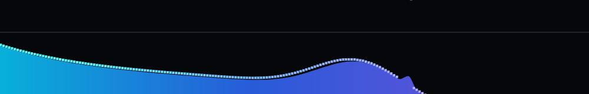

> 补充：如果屏幕是**一条平线**（像静音时那样），那不是 bug —— 音源模式没有声音时整个频谱就是贴底的，
> 峰值点自然也成一条水平线。放点音乐再看。


---

## 峰值标记改成「与频谱一一对应」（每带 1 个）· 2026-11-07

用户：**「最大值的点我不定制大小了，做成和频谱一一对应，就像样式-波形那样就行」**。

- 不再自定义点的大小/密度：**每带 1 个标记**（144 个，和 144 根柱子一一对应）；
- 宽度取**一根柱子的宽度**（`bandW × barFactor`），高度固定 `max(4, bandW×0.22)`；
- 位置：本带中心，压在峰值（或面积曲线）之上；
- 三角档共用这条分支，也变成每带 1 个。

```java
float capW = Math.max(3f, bandW * barFactor);   // 与柱子同宽
float capH = Math.max(4f, bandW * 0.22f);       // 固定高度，不随样式变
for (int i = 0; i < bands; i++) {
    float yRaw = base - p[i] * barSpanH;
    if (style == 4) { float fy = areaCurveY(i, 0.5f, bandW); if (fy > 0f && fy < yRaw) yRaw = fy; }
    float y = yRaw - capH;
    float x = left + (i + 0.5f) * bandW;
    tmp.set(x - capW / 2f, y, x + capW / 2f, y + capH);
    c.drawRect(tmp, peakPaint);
}
```


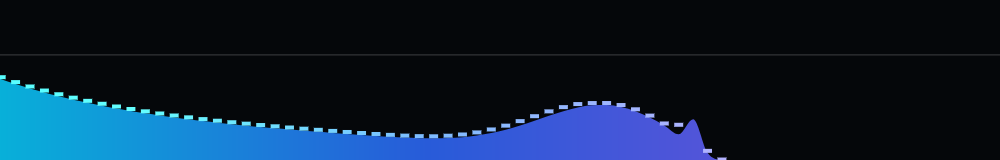


---

## 面积档改成「波形档的画法 + 颜色填充」（2026-11-07）

用户：**「把样式-面积的显示方式改成和样式-波形一模一样的逻辑，保持颜色填充即可」**。

现在面积档 = 波形档的绘制逻辑 **+** 下方的颜色填充：

| 图层 | 波形档 | 面积档（现在）|
|---|---|---|
| 顶部曲线 | 包络线（描边）| **同一条曲线**（单调三次插值）|
| 下方填充 | 无 | ✅ 用同一个 shader 填充（alpha 215）|
| 包络线 | ✅ | ✅（新增）|
| 峰值 | **连续曲线** | **连续曲线**（同一段代码）|

实现上把面积顶部曲线存成一条独立的 `areaTopPath`（单调三次插值），
填充 = 它 + 底边闭合，描边直接 `drawPath(areaTopPath, linePaint)`；峰值走和波形档一样的 quadTo 曲线。

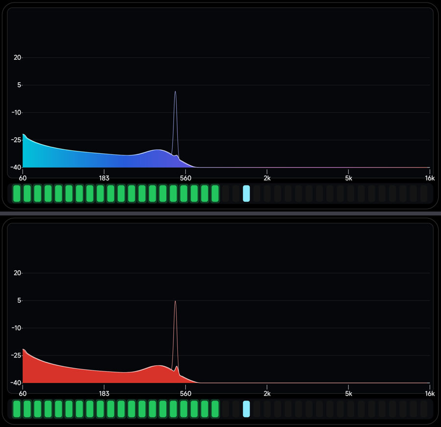
