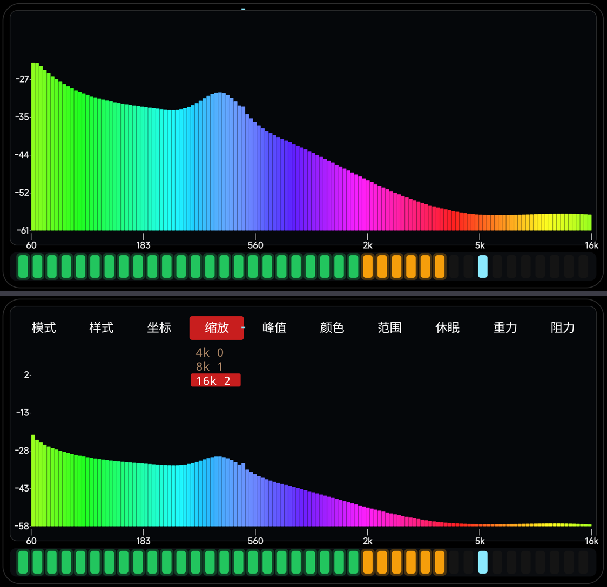

# 「范围」菜单是干什么的 · 2026-11-07

用户问：**「范围那个按钮菜单是干什么用的」**。

它控制的是**纵轴（电平）的刻度方式** —— 也就是"屏幕上多高算多响"。

| 选项 | 含义 | 效果 |
|---|---|---|
| **自动**（默认）| 显示窗口跟着信号强弱自动升降 | 不管放的是轻音乐还是大编制，图像都**差不多占满整个高度**（相对刻度）|
| **-60** | 固定地板 −60 dBFS，顶永远是 0 dBFS | **绝对刻度**：安静的段落柱子就矮，响的段落才高 |
| **-80 / -100** | 同上，地板更低，能看到更安静的内容（也更容易把噪声画出来）| |

对比图（同一段假频谱信号）：

- **上图（自动）**：纵轴 −27…−61，柱子铺满高度；
- **下图（固定 -60）**：纵轴 2…−58（顶=0 dBFS），同样的信号只占下半屏 —— 因为它的绝对电平就是
  −20…−50 dBFS 这个范围。

另外「增益」（右侧上下滑）在两种模式下都会**整体平移显示窗口**，所以纵轴刻度也会跟着移
（下面那张图纵轴顶显示 2 而不是 0，就是因为当时增益是 −2.4 dB）。

一句话：**自动 = 相对刻度（永远好看）；-60/-80/-100 = 绝对刻度（能比较响度）**。
