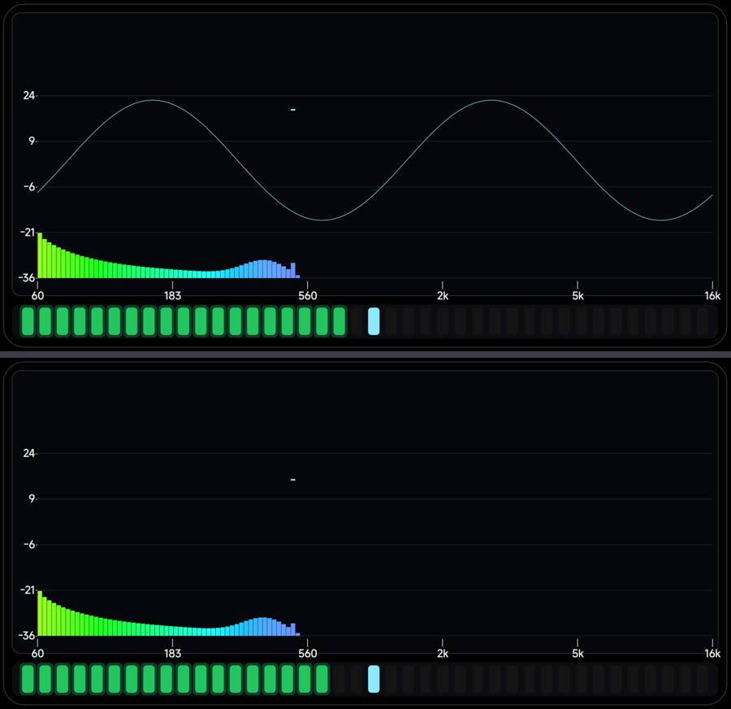
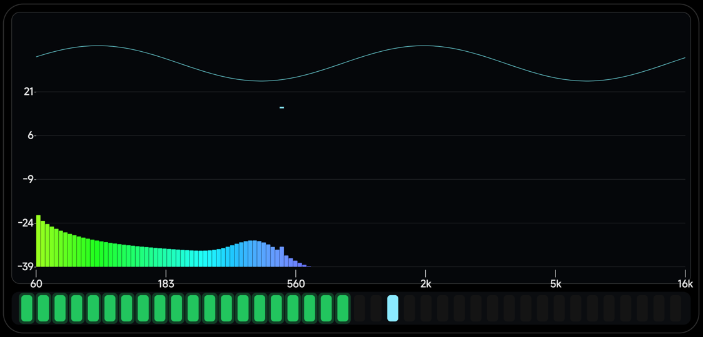

# 「显示 → 声波」：把当前时域波形叠加在频谱图上 · 2026-11-07

用户：**「在显示按钮里面再控制 显示当前声波，直接叠加在频谱图的图层上」**。

## 数据来源

之前 `SpectrumFrame` 只带频谱（每带 dB），这次加了**时域波形**（256 点，−1..1）：

| 音源 | 波形从哪来 |
|---|---|
| 麦克风 | `Analyzer` 从本轮 1024 点 hop 里等距抽 256 点 |
| 音源（系统混音）| `Visualizer` 的 8-bit waveform 回调，减 128 后抽 256 点 |
| 假频谱 | 合成一段正弦（验证用）|

`SpectrumProvider.WAVE_POINTS = 256`，帧池里每帧都预留了这 256 个 float（零分配）。

## 绘制

- 开关：「显示」第 5 项 **声波**（位掩码 bit4 = 16，默认**关**）；
- 位置：横跨整个频谱宽度，**以频谱区域中线为 0 线**，振幅占高度的 30%；
- 自动放大：按本帧峰值归一（上限 40 倍），所以轻信号也看得见、强信号不会溢出；
- 颜色：淡青色 `0xCC7DF9FF`，线宽 2px；
- **层级**：在坐标轴之后、所有频谱图层之上 —— 也就是直接叠在图上。



> 上图（掩码 31）能看到那条青色正弦；下图（掩码 15）关掉了。


---

## 位置调整：挪到屏幕顶部区域（2026-11-07）

用户：**「把波形绘制在屏幕的 24 横坐标和屏幕顶部区域」** —— 也就是频谱上沿那条空带，
纵坐标最上面那条刻度线之上。

```java
float bandH = specRect.height() * 0.20f;     // 顶部 20% 的空带
float cy    = specRect.top + bandH * 0.5f;   // 0 线在这条带的中线
float amp   = bandH * 0.46f;                 // 振幅占带高 92%
```

这样波形和频谱**不会互相遮挡**：频谱在下面，波形独占顶部那条空带（峰值点飞过时会有短暂交叠，正常）。


