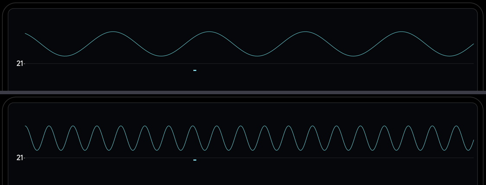

# 波形卡顿的原因 / 时间尺度（时基）· 2026-11-07

## 一、为什么之前看着卡顿

两个独立原因：

### 1. 没有"触发"——每帧窗口相位都是随机的

示波器不是"随便抓一段就显示"，而是**对齐到一个固定相位**（通常是上升过零点）再画。
之前我们是每帧把当前 20ms 原样画出来，于是每一帧的起点相位都不一样 —— 波形看起来就是
**乱跳/卡顿**，哪怕帧率有 47fps。

**修复**：在 provider 里把快照**循环移位到第一个上升过零点**：

```java
int trig = 0;
for (int i = 1; i < hop / 2; i++) {
    if (win[base + i - 1] < 0f && win[base + i] >= 0f) { trig = i; break; }
}
for (int k = 0; k < wp; k++) wave[k] = win[base + (trig + k) % hop];
```

现在连续两帧的波形起点相位一致 → 波形**稳定不跳**（真正的示波器观感）。

### 2. 更新率受分析帧率限制

| 音源 | 波形刷新率 | 说明 |
|---|---|---|
| 麦克风 | ≈47 fps | 每 hop（1024 点）一帧，够顺 |
| 音源（系统混音）| **≈20 fps** | `Visualizer` 回调本身就约 20 fps，这是系统上限，改不了 |

所以音源模式下波形会比麦克风模式更"跳"一些 —— 这是 API 限制，不是 bug。

## 二、时间尺度缩放：新增「时基」菜单

用户：**「时间尺度缩放怎么做」** → 已经做成顶栏第 12 项 **「时基」**：

| 选项 | 显示多长时间 | 说明 |
|---|---|---|
| 5ms | 240 点 @48k | 看细节（接近单周期）|
| **10ms**（默认）| 480 点 | 折中 |
| 20ms | 960 点 | 看整体包络 |

实现：帧里带 **1024 点**（≈20ms @48k）快照，渲染时按 `时基 × 48` 算点数，
只画**最新**的那一段（`from = waveLen - want`），所以是**滚动示波器**的效果：

```java
int want = Math.min(waveLen, Math.max(32, ms * 48));
int from = waveLen - want;         // 显示最新的一小段
```



> 上图 5ms 约 4.7 个周期，下图 20ms 约 18.7 个周期 —— 同一信号的不同时间尺度。
