# 顶栏两行化 + 频谱加横纵坐标刻度 · 2026-11-07

## 1. 顶栏改成两行，按钮间距拉大

用户：**「重构一下顶栏的操作按钮，按钮的间距大一点，现在不方便触摸」**。

原来 11 项挤在一行（每项约 190px 宽 × 70px 高，Mi 10 上很难点准）。现在：

| | 改前 | 改后 |
|---|---|---|
| 行数 | 1 行 11 项 | **2 行（6 + 5）** |
| 单项宽 | ≈190px | **≈350px（×1.85）** |
| 单项高 | 70px | **97px（×1.4）** |

- 第一行：模式 样式 坐标 缩放 峰值 颜色
- 第二行：范围 歌词 休眠 重力 阻力
- 子菜单统一从**整条菜单栏下方**展开（不再遮住第二行按钮）
- 选中项改成整块底色高亮（原来是文字外的小药丸）

## 2. 频谱加横纵坐标刻度

用户：**「把横纵坐标都加上」**，随后补充 **「纵坐标轴放在左边 不要和图像重合」**。

- **横轴（频率）**：频谱下方独立刻度带，6 个刻度 + 短竖线。
  对数坐标按 `f = fMin·(fMax/fMin)^t` 取点，实测标签 `60 / 183 / 560 / 2k / 5k / 16k`；
  线性坐标则按等分取点。
  `fMin` 由 provider 通过 `SpectrumProvider.fMin()` 上报（麦克风 60Hz / 音源 90Hz）。
- **纵轴（电平 dB）**：**频谱左侧留出 5.2% 宽的独立刻度带**，右对齐 5 个 dB 刻度 + 短横线，
  **完全不压在图像上**。刻度值按当前量程与柱高映射反算，所以和柱子高度严格对应
  （自动量程下就是 `floor … floor+span`）。

布局连带调整：顶栏变两行后频谱区整体下移（`specTop: 卡片高 14.5% → 30%`），
底部给横轴留 9.5%（原 3%），左侧给纵轴留 5.2%。

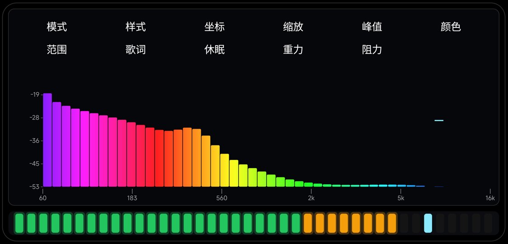
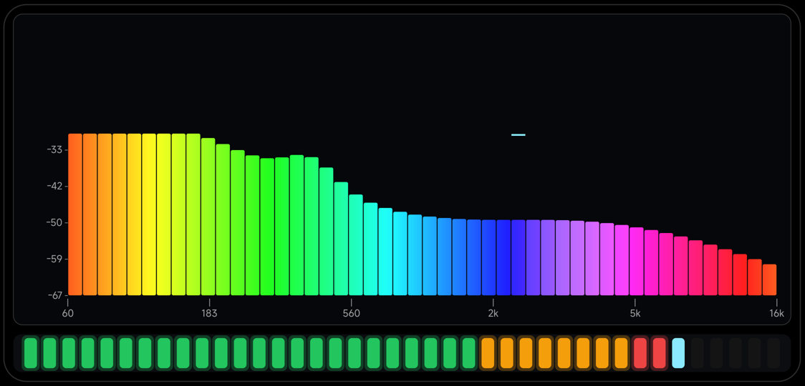


---

## 3. 谱线密度再提高（2026-11-07）

用户：**「谱线的密度再高一些」**。

| 项 | 改前 | 改后 |
|---|---|---|
| 柱数（麦克风 + 音源共用 `PcmProvider.BANDS`）| 96 | **144** |
| 柱形档柱宽占比 `barFactor` | 0.62 | **0.72**（缝更小）|
| 假频谱（验证用）| 48 带 | 跟随 144 带，脉冲带按比例分布 |

实测：`bands=144`、渲染 **1.41 ms**、**90 fps**（预算 16.7 ms，还很宽裕）。

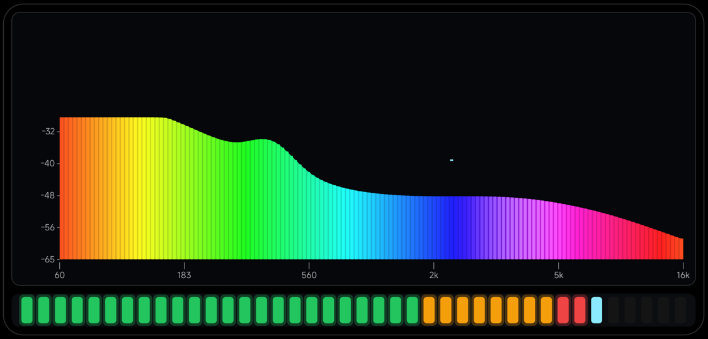


---

## 4. 纵坐标靠近屏幕左边缘（2026-11-07）

用户：**「纵坐标距离屏幕左侧边缘太远了」**。

| 量 | 改前 | 改后 |
|---|---|---|
| 卡片左右内边距 `cardPadX` | 卡片宽 1.8% | **0.8%** |
| 纵轴刻度带 `yAxisW` | 卡片宽 5.2% | **2.2%**（只够一个标签字宽）|
| 标签到频谱左缘空隙 | `0.55×字高` | **`0.25×字高`** |
| 实测：纵轴文字最左 x | 184 px | **145 px** |

（其中 92px 是系统给导航栏预留、App 画不到的区域；剩下 53px 是机身边框 + 卡片内边距。）

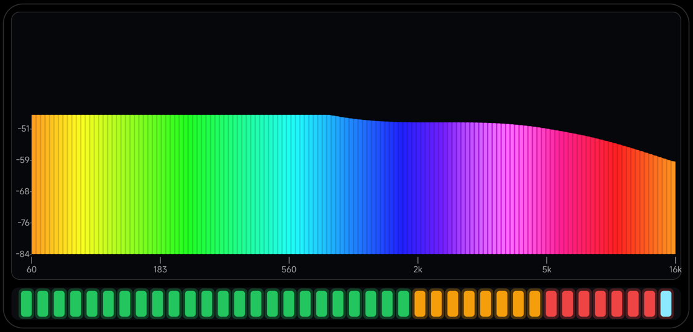


---

## 5. 坐标数字加粗（2026-11-07）

用户：**「横纵坐标指的数字加粗一点 现在看不清」**。

| 项 | 改前 | 改后 |
|---|---|---|
| 字重 | 常规 | **假粗体**（`setFakeBoldText(true)`）|
| 字号 | 卡片宽 1.25% | **1.48%** |
| 颜色 | `0x9AFFFFFF`（60% 白）| **`0xE6FFFFFF`（90% 白）** |
| 纵轴带宽度 | 卡片宽 2.2% | 2.8%（放得下加粗的字）|


---

## 6. 顶栏恢复一排 / 频谱上提 / 横轴移到图像下方 / 删除歌词（2026-11-07）

用户依次要求：
1. **「顶部按钮恢复成一排」**
2. **「频谱要能到达屏幕最高端 现在高度被限制太狠了」**
3. **「横坐标不要放在图像上面 放在底下」**
4. **「把歌词功能删除」**

| 项 | 改前 | 改后 |
|---|---|---|
| 顶栏 | 两行（6+5）| **一排 10 项**（删掉「歌词」后）|
| 频谱上沿 | 卡片高 30% | **10.5%**（紧贴单行菜单下方）|
| 频谱下沿 | 90.5% | **93.8%**（底部留 6.2% 给横轴）|
| 横坐标位置 | 图像上方 | **图像下方** |
| 歌词菜单 | 有（「关 / 同名lrc」）| **整项删除** |

- 删「歌词」后菜单索引变化（休眠/重力/阻力 各前移一位），所以偏好键从 `v2_sel` 换成了
  **`v3_sel`**，避免旧值错位（代价是设置会回默认一次）。
- 歌词相关的 `drawLyrics()` 一并删掉；**只保留**音源模式那条「媒体音量为 0，请调大音量」的兜底提示
  （改名为 `drawSilenceHint()`）。

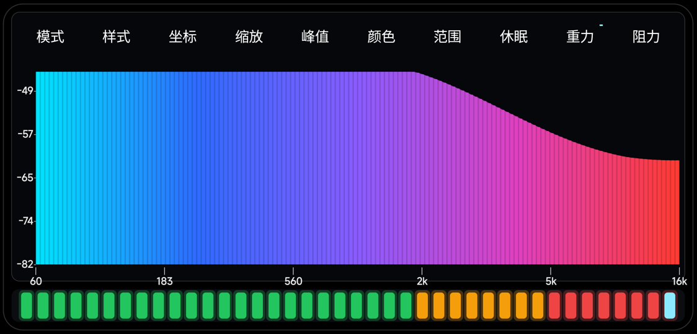


---

## 7. 样式菜单合并（柱形 = 原密线）+ 线性横坐标从 0 开始（2026-11-07）

### 7.1 样式：删掉原「柱形」，把「密线」改名「柱形」

用户：**「模式里面的柱形 和密线 是同一个功能，把柱形删除，把密线改成柱形」**。

两档本来就都是"密集离散谱线、无面积无包络"，区别只是柱宽占比（0.62 vs 0.94），确实重复。

「样式」菜单 7 项 → **6 项**（默认改为「柱形」）：

| 序号 | 0 | 1 | 2 | **3** | 4 | 5 |
|---|---|---|---|---|---|---|
| 名称 | 波形 | 三角 | 面积 | **柱形** | 实心 | 疏线 |
| 画法 | 只包络线 | 三角柱 | 面积+包络 | **密集谱线（无面积/包络）** | 实心包络 | 稀疏细线 |

绘制层按新序号重排：

```java
boolean drawArea = style == 2 || style == 4;
boolean drawBars = style == 3 || style == 5;
boolean drawTri  = style == 1;
boolean drawLine = style == 0;
float barFactor  = style == 3 ? 0.94f : (style == 5 ? 0.26f : 0.62f);
```

菜单序号变了，偏好键从 `v3_sel` → **`v4_sel`**（设置会回默认一次）。

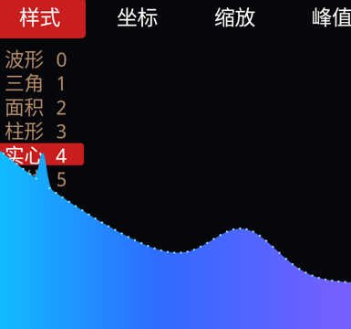

### 7.2 横坐标从 0 开始

用户问：**「横坐标为什么不是从零开始？」**

两个原因：
1. **对数坐标不可能从 0 开始** —— `log(0) = −∞`，这是数学限制；对数档只能从 `fMin` 起
   （麦克风 60 Hz / 音源 90 Hz，也正是 FFT 在 48k/2048 点下能分辨的下限附近）。
2. 0 Hz 是**直流分量**，不是有效音频。

**线性坐标是可以从 0 起的**，之前没做到，现已修：

```java
// BandMapper：线性档从 0 Hz 等分（原来是从 fMin 起）
f0 = fMax * k / bands;
// 0 Hz 那根柱子的几何中心是 0，倾斜补偿会算出 −inf → 兜到 20 Hz
centerHz[k] = Math.max(20.0, sqrt(f0 * f1));
```

横轴标签同步改：线性档 `f = fMax × t`（0 起），对数档仍按 `fMin·(fMax/fMin)^t`。

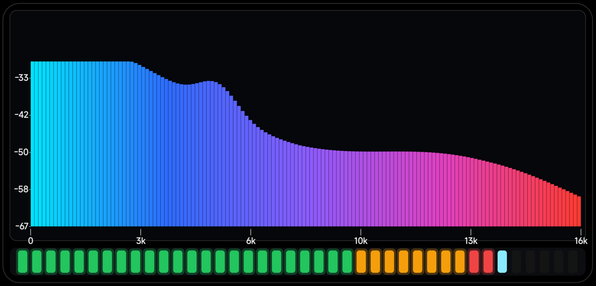


---

## 8. 峰值点密度：所有样式统一到「每带 3 个」（2026-11-07）

用户先后反馈：**「柱形模式的最大值点密度太低」**、**「面积模式的最大值点密度太低，应该参考波形档的密度」**。

原因是峰值点的绘制分了两条分支，密度不一致：

| 样式 | 改前 | 改后 |
|---|---|---|
| 柱形 / 疏线 | 每带 **1 个**宽帽（0.94×柱宽）| 每带 **3 个**窄帽（0.34×柱宽，相邻插值）|
| 波形 0 | 每带 3 个小方块 ✓ | 同左 |
| 三角 / 面积 / 实心 | 每带 **1 个**小方块 ✗ | **每带 3 个**（与波形一致）|

现在所有样式的峰值点密度都是 **144×3 = 432 个** ✓


---

## 9. 波形档的峰值画成连续曲线（2026-11-07）

用户：**「样式-波形 的峰值画成连续的曲线」**。

原来峰值点在任何样式下都是离散小方块（波形档是每带 3 个）。现在**只有波形档**改成
用 `Path.quadTo` 串起来的圆滑曲线（和包络线同样的连接方式），线宽 `max(2px, 带宽×0.14)`；
其余样式仍是每带 3 个点（面积/三角/实心）或 3 个帽（柱形/疏线）。

- 峰值曲线用 `Theme.PEAK_DOT` 亮青色描边，与白色包络线区分开；
- 因为峰值本来就允许飞出屏幕，曲线在强瞬态时会直接冲出上边缘 ✓。

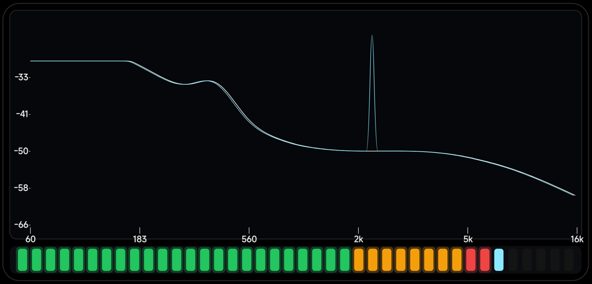


---

## 10. 面积档的峰值点：变少、变大（2026-11-07）

用户：**「样式-面积 的峰值不用这么密集，把峰值点的大小变大一点」**。

面积档（style 2）单独一条分支：

| 项 | 改前 | 改后 |
|---|---|---|
| 密度 | 每带 3 个 | **每带 1 个** |
| 尺寸 | `max(2.5, 带宽×0.16)` ≈ 3px | **`max(5, 带宽×0.55)` ≈ 11px** |
| 总点数 | 144×3 = 432 | **144** |

三角 / 实心 仍保持每带 3 个小点（用户没提，暂不改）。

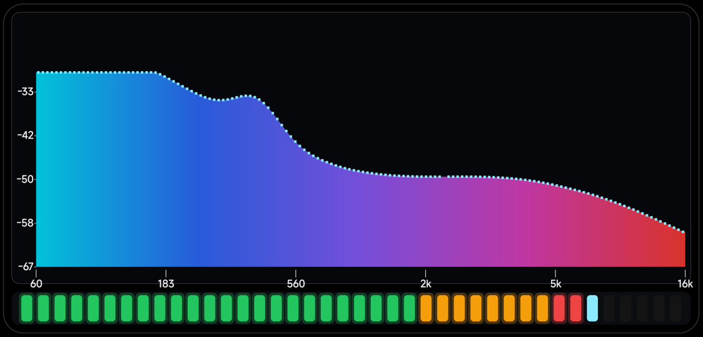


### 面积档峰值点：第二次微调（每带 2 个、中等尺寸）

用户：**「稍微小点，密度高点」**（在"每带 1 个、11px"的基础上）。

| 项 | 上一版 | 现在 |
|---|---|---|
| 密度 | 每带 1 个 | **每带 2 个**（相邻带插值）|
| 尺寸 | `max(5, 带宽×0.55)` ≈ 11px | **`max(4, 带宽×0.36)` ≈ 7px** |
| 总点数 | 144 | **288** |

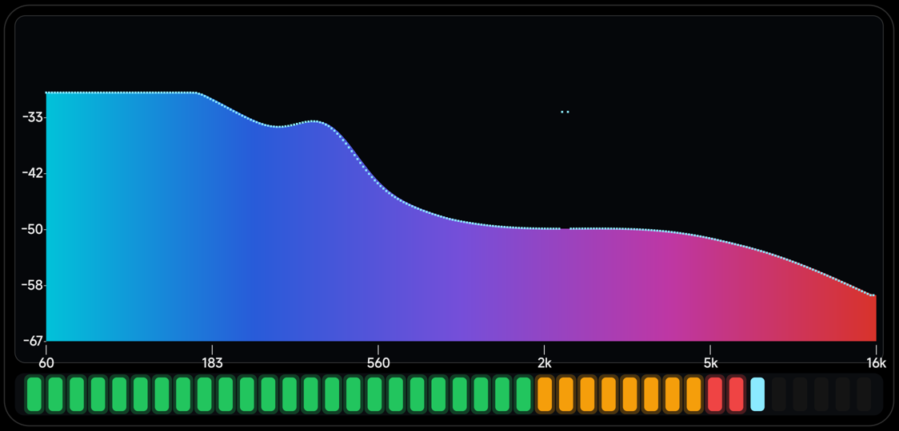


---

## 11. 样式菜单最终顺序：柱形 疏线 三角 波形 面积（删掉实心）· 2026-11-07

用户：**「样式菜单的排布顺序改成 柱形 疏线 三角 波形 面积，把实心删除」**。

菜单 6 项 → **5 项**，索引重排：

| 新序号 | 0 | 1 | 2 | 3 | 4 |
|---|---|---|---|---|---|
| 名称 | **柱形** | **疏线** | **三角** | **波形** | **面积** |
| 原序号 | 3 | 5 | 1 | 0 | 2 |
| 画法 | 密集谱线（0.94×带宽）| 稀疏细线（0.26×）| 三角柱 | 只包络线 + 峰值曲线 | 面积 + 包络线 |

删掉的「实心」（原 4，不透明面积填充）不再提供。

绘制层按新序号重排：

```java
boolean drawArea = style == 4;
boolean drawBars = style == 0 || style == 1;
boolean drawTri  = style == 2;
boolean drawLine = style == 3;
float barFactor  = style == 0 ? 0.94f : (style == 1 ? 0.26f : 0.62f);
```

峰值绘制跟着改：波形曲线 → `style == 3`；面积每带 2 点 → `style == 4`；柱形/疏线仍每带 3 个窄帽。

序号又变了，偏好键 `v4_sel` → **`v5_sel`**（设置回默认一次，默认样式就是「柱形」）。

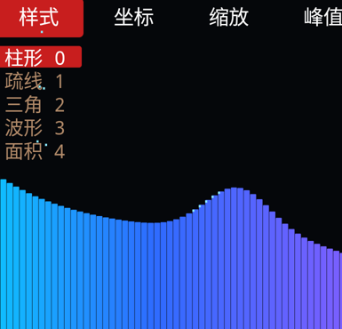


---

## 12. 「缩放」为什么看着没用（2026-11-07）

用户：**「缩放按钮是不是没用？只有横坐标值变了，但是图形没变」**。

### 缩放本身是好的 —— 用自检五音验证

自检信号是 60 / 250 / 1k / 4k / 10k 五个固定频率：

| 缩放 | 峰组数量 | 峰位（x 像素）|
|---|---|---|
| 16k | **5** | 204 / 672-796 / 1232-1272 / 1760 / 2096 |
| 4k | **4** | 204 / 828-996 / 1572-1616 / 2272 |

切到 4k 后，**10k 那个峰消失了**，其余峰位按新映射右移 —— 说明 `setFMax → 重建 BandMapper → 重新分带`
这条路是通的 ✓

### 真正的原因：假频谱源当时忽略了缩放

`FakeProvider.setFMax()` 里写着"固定形状，不随缩放变化"，而我最近大量用
`--ez fakespectrum true` 调试 —— 在那个源上，坐标标签会变、图形确实不动 ✗。

**已修**：假频谱现在按 `fMax/16000` 压缩自己的形状，缩放时图形会跟着变。

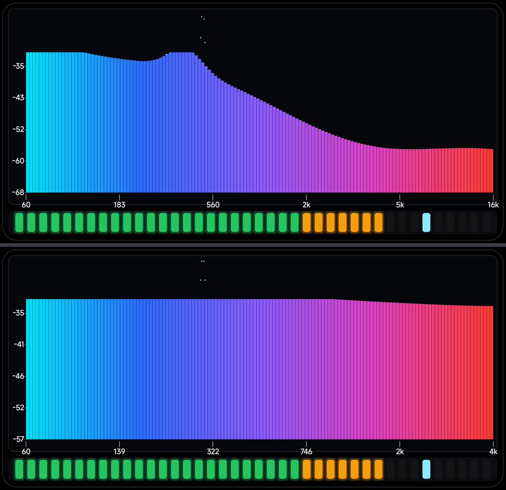

> 如果你是在**麦克风/音源**模式下看的，那缩放本来就是生效的；只有在 fakespectrum 模式下才不动。


---

## 13. 柱形档的峰值恢复成"等宽矩形"（2026-11-07）

用户：**「样式-柱形 的峰值还是使用原来的矩形表示」**（之前我为了加密度改成了每带 3 个窄帽）。

| 项 | 上一版 | 现在 |
|---|---|---|
| 数量 | 每带 **3 个**窄帽（0.34×柱宽）| **每带 1 个** |
| 宽度 | `barW × 0.34` | **= 柱宽 `barW`**（与下方谱线同宽）|
| 高度 | `max(5, 带宽×0.12)` | 同左 |
| 贴顶时不画 | ✓ | ✓（避免"同一频率两个点"）|

疏线档共用这条分支（柱宽 0.26×），所以它的帽也跟着变成等宽矩形。

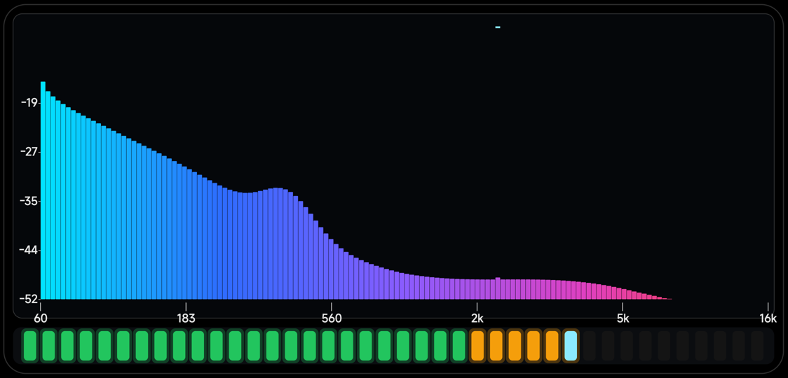
